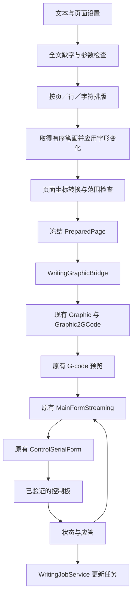

# AutoWriter 二次开发说明与阶段实施计划

> 文档日期：2026-10-05。开发底座：用户 fork 的 GRBL-Plotter。本文依据本地源码编写，属于待实施的开发方案；文中新增类、配置字段、阶段版本和性能指标均为设计要求，不表示已经实现或实机验证。

> 2026-10-05 补充：已对照用户提供的 12 张奎享界面截图扩充需求，详见第 19 节。截图可确认界面入口和可见参数，不能单独证明其内部算法、设备能力或实际运行结果。

## 1. 开发目标与当前基线

### 1.1 项目目标

在现有 GRBL-Plotter 上增加适合中文写字机器人的操作流程，使用户能够完成：选择机器 → 输入文字 → 设置纸张、字体和排版 → 检查实际笔画路径 → 书写当前页 → 暂停或换页 → 保存项目。

开发优先复用底座的串口通信、G-code 生成、路径显示和任务发送。第一阶段利用现有机器建立可验证的控制基线，然后逐步加入中文笔画和页面功能。机械结构与控制板的升级安排在软件验证之后，根据实测问题决定。

### 1.2 已核对的软件事实

| 项目 | 当前事实 | 开发含义 |
|---|---|---|
| 工作目录 | `D:\yy-code-git\autowriter` | 源码直接位于项目根目录，无额外嵌套仓库 |
| fork | `https://github.com/perfectddt/GRBL-Plotter-2` | 用户自己的开发仓库 |
| 当前分支 | 编写本文时为 `master` | 后续功能在独立功能分支开发 |
| 源码基线提交 | `20d574c960a2f1c351cbc5e8818db6e463abf8c3` | 模块映射与判断以此提交为基准 |
| 程序版本 | `1.8.1.0` | 见 `Properties/AssemblyInfo.cs` |
| 技术栈 | C#、Windows Forms、.NET Framework 4.8 | 以 `.csproj` 和 `App.config` 为准；README 的 .NET 4.0 说明已落后于代码 |
| 工程格式 | 传统 `.csproj`，显式列出源码与资源 | 新建 `.cs`、`.resx`、数据文件后需要加入工程 |
| 依赖管理 | `packages.config` 加仓库内 `DLLs` | 恢复 NuGet 不能替代检查本地 DLL 引用 |
| 文字功能 | `GCodeFromText` 窗口；Hershey、LFF、SVG 字体与系统字体分支 | 已有文字入口，可以增量扩展 |
| 中文数据 | 附带 `unicode.lff`，统计有 2,626 个字形条目，其中 1,960 个属于基本 CJK 区间 | 包含部分汉字，不代表完整常用汉字覆盖 |
| 文字路径处理 | 图形链路存在路径接续、合并、距离排序和反向处理 | 中文书写必须建立明确的保序规则 |
| 机器控制 | 底座已有 GRBL 通信、状态处理和任务发送模块 | 适配时复用，避免引入另一个串口发送器 |
| 自动化测试 | 未发现独立的测试工程 | 后续为新增纯算法和必要的协议边界建立验证 |

中文覆盖统计仅按 LFF 字形条目编号计数。它不证明数据完整、字形美观或笔顺正确。例如，当前文件中的“中”由五条独立线段组成，第一条是竖线，不能直接当作规范书写笔顺。

当前字体文件头写有 `GPL v2 or later + unknown`。该文件可以用于研究现有解析链路；正式随产品分发前，需要查清不明确的来源或换用许可清楚的数据。

### 1.3 当前电脑的开发条件

已发现 Visual Studio 2022 Professional，安装目录为 `H:\Program Files\Microsoft Visual Studio\2022\Professional`，其 MSBuild 程序存在。当前终端 PATH 中没有直接找到 `msbuild` 和 `nuget`，仓库根目录也尚无 `packages` 恢复目录。

默认参考程序集目录中未发现 `v4.8` 子目录，因此 **.NET Framework 4.8 Targeting Pack 是否齐备仍需阶段 0 核对**。本次编写文档没有恢复依赖、编译程序或连接机器，不能据此声称项目已经能够运行。

### 1.4 已有机器的线索与待确认项

此前在奎享软件文件和用户配置中发现以下信息；这些是旧软件配置线索，尚未通过设备反馈确认：

| 已有线索 | 使用原则 |
|---|---|
| 用户机器类型记录为 `Grbl` | 优先尝试验证 GRBL 协议兼容性 |
| 保存波特率为 `115200` | 作为首次连接候选，不当作所有设备的固定值 |
| 曾保存端口 `COM9` | 每次枚举实际串口，不能固定写死 COM9 |
| 坐标配置曾选择左上角并反转 Y 轴 | 先测实际正方向；只允许在一处执行页面到机器坐标转换 |
| 默认笔控记录为 `Stepper` | 需要确认实际是 Z 轴、舵机还是定制笔控 |
| 两份配置的落笔 Z 值分别为 5 和 10，抬笔为 0 | 不选择其中任何一组作为默认运动参数 |
| 商品名为“2026 豪华 Plus 版、空气悬浮、无声版” | 无法据此推断电路、固件、电机或行程 |

新截图中，机器设置实际显示“步进笔控写字机”、抬笔位置 0、落笔位置 5、速度 10000；坐标设置显示左上起点、反转 Y 轴。主界面显示 COM9、115200 和“断开”按钮，状态栏显示固件版本 1.3。这些补充了**截图拍摄时的界面配置**，仍不能证明控制板的协议版本或上述数值对应的实际行程。特别不能将界面版本 1.3 直接等同于官方标准 GRBL 的版本。

阶段 1 必须补全：控制板标识、固件版本、X/Y/Z 的实际结构、限位与回零能力、可用行程、抬落笔方向、电机运动参数、断线后的行为。没有通过验证的设备配置可以预览，不能用于开始书写。

## 2. 功能范围与优先级

### 2.1 第一版应达到的使用流程

1. 打开写字模式，选择已经验证的机器配置。
2. 输入中文、英文、数字与常用标点。
3. 选择笔画字库，设置纸张、边距、字高、字距和行距。
4. 看到与实际运行一致的笔画预览，以及缺字、越界和未配置项。
5. 将选中的一页加载到原有 G-code 预览和发送流程。
6. 开始、暂停、继续或取消任务；结束后等待机器确认空闲。
7. 保存文档，能够再次打开并得到同样的排版和路径。

第一版以单页纯文本为目标。多页模板、横线纸校准和可靠任务恢复分阶段加入。

### 2.2 功能要求

| 编号 | 功能 | 优先级 | 首次实现阶段 | 具体要求 |
|---|---|---|---|---|
| F-01 | 机器配置 | 必须 | 1 | 记录协议、端口候选、笔控方式、行程与校准状态；未校准项有明确提示 |
| F-02 | 串口连接与状态 | 必须 | 1 | 显示连接、空闲、运行、暂停、报警和断线；读取真实反馈 |
| F-03 | 写字模式入口 | 必须 | 2 | 增加面向书写的中文设置区，并能进入原有高级控制界面 |
| F-04 | 页面与文本编辑 | 必须 | 2 | A4 与自定义尺寸、边距、字高、字距、行距、自动换行 |
| F-05 | 中文笔画字库 | 必须 | 3 | 提供按字符、笔画编号组织的单线数据；启动前检查全文缺字 |
| F-06 | 实际路径预览 | 必须 | 2–3 | 预览实际将发送的路径，区分落笔与空移，能查看单字笔顺 |
| F-07 | 启动前检查 | 必须 | 2–3 | 字库、页面范围、机器校准、笔控与已生成任务快照一致 |
| F-08 | 文档保存与打开 | 必须 | 2–4 | 版本化 JSON，保存排版、字体版本与变化种子；兼容性失败时明确报错 |
| F-09 | 暂停、继续、取消 | 必须 | 2、5 | 复用原有发送流程，验证实际状态；取消后不得显示“已完成” |
| F-10 | 多页与人工换页 | 应有 | 4 | 页列表、当前页选择、换纸确认、续写页号；页面之间完成抬笔与排空 |
| F-11 | 横线纸模板 | 应有 | 4 | 第一条基线、固定行距、页边距、纸张放置基准 |
| F-12 | 字形变化 | 应有 | 4 | 小幅位置、缩放和旋转变化可关闭，使用固定种子，保留字符及笔顺 |
| F-13 | 故障恢复 | 应有 | 5 | 记录保守检查点；恢复前重新验证位置、文件与设备配置 |
| F-14 | 本人笔迹录制 | 可选 | 后续 | 逐字逐笔画采集、版本管理、质量筛选；不占用首版交付时间 |
| F-15 | Word/PDF 导入 | 可选 | 后续 | 作为独立转换功能；第一版先提供纯文本粘贴和导入 |
| F-16 | 多色、自动换笔、相机校准 | 可选 | 后续 | 在基础书写与机械结构确定后开发 |
| F-17 | 多种内容模式 | 分批实现 | 2、4、后续 | 笔记、文字、表格、格子、波浪图、单线字、边缘图和实心图分别定义输入与输出，不只增加菜单 |
| F-18 | 按行数排版、字高比例 | 必须 | 2 | 行数与行距两种控制方式互斥；字高比例基于明确的排版框计算 |
| F-19 | 多字库权重混用 | 应有 | 3 | 候选字库、非负权重、缺字回退、固定随机种子与混用预览 |
| F-20 | 字符宽度与基线调整 | 应有 | 3–4 | 特殊字符额外宽度、空格、制表符、基线偏移与上下浮动，单位和含义清楚 |
| F-21 | 字形变化范围 | 应有 | 4 | 大小、字距、旋转、水平／垂直拉伸、行首变化；独立开关和上下限 |
| F-22 | 内容整体变换 | 必须 | 2、4 | 偏移、90°／180°旋转，后续任意角度；统一旋转中心和越界检查 |
| F-23 | 运动速度和动作延迟 | 必须 | 1–2 | 写字、空移与 Z 速度分开，明确 G0 速度控制来源；上下笔延迟有独立字段 |
| F-24 | 设备诊断与命令工具 | 必须 | 1、5 | XY/Z 点动、机械回零、工作零、复位、解除报警、电机控制及自定义命令按能力开放 |
| F-25 | 任务起始／结束命令 | 应有 | 5 | 机器配置中的高级项，校验模态和动作影响，纳入页面摘要与任务验收 |
| F-26 | 完成后动作与耗时 | 应有／可选 | 5–6、后续 | 预计与已用时、完成通知；机器休眠按能力实现，电脑关机作为明确启用的可选功能 |
| F-27 | 步进与脉冲参数计算 | 应有 | 1、H | 步距角、细分、传动、电子齿轮与实测校准；计算结果不自动写入固件 |
| F-28 | 图片物理尺寸与转换限制 | 可选 | 后续图像扩展 | DPI、最大像素、笔宽、边缘／填充路径，复用已有图像导入能力 |
| F-29 | 模板和字体管理 | 应有 | 3–4 | 搜索、预览、导入、保存和删除；字体下载／云同步单独评估 |
| F-30 | 连接与原点自动操作 | 应有 | 1、5 | 自动连接和设置工作零独立可配置，启动／重连期间不自动运行任务 |
| F-31 | 单步调试 | 应有 | 5 | 明确代码行／笔画粒度，等待运行结束后才允许下一步；不把单条应答当作执行完成 |

### 2.3 第一版暂不列入验收的能力

复杂 Word/PDF 原样还原、图片识别成笔画、自动连写所有汉字、连续压力模拟、自动翻页、多机器队列、云账户和手机控制不作为第一版要求。记录这些需求时应注明解决的实际问题、硬件依赖和额外开发成本。

截图新增需求按第 19 节分批纳入，表格、格子与字体混用补入阶段任务；图片模式、联网字体资源和电脑关机归入扩展范围。截图里的“PDF页”按钮仅作为待确认入口，不据此承诺完整 PDF 导入或导出。

## 3. 源码模块与接入位置

以下文件已经存在；后面列出的 AutoWriter 类与目录属于新增设计。

| 职责 | 现有文件 | 关键入口／检查点 | 建议改法 |
|---|---|---|---|
| 程序启动 | [Program.cs](../GRBL-Plotter/Program.cs) | `Main()`，启动 `MainForm` | 第一轮保持启动结构，写字模式作为现有程序功能 |
| 主窗口 | [MainForm.cs](../GRBL-Plotter/GUI/MainForm.cs) | 窗口初始化、现有菜单和设备控制 | 仅添加写字入口和必要状态显示 |
| 文字窗口打开 | [MainFormOtherForms.cs](../GRBL-Plotter/GUI/MainFormOtherForms.cs) | `TextWizzardToolStripMenuItem_Click()` | 复用现有 `GCodeFromText` 窗口生命周期 |
| 文字设置与生成 | [GCodeFromText.cs](../GRBL-Plotter/GCodeCreation/CreateFromForm/GCodeFromText.cs) | `CreateText()`、`FillFontSelector()`、`btnApply` | 增加写字模式分支，把排版算法移入小型服务 |
| 单线字体读取 | [GCodeFromFont.cs](../GRBL-Plotter/GCodeCreation/CreateFromForm/GCodeFromFont.cs) | `FontFileName()`、`Reset()`、`GetCode(double pageWidth)` | 复用已有 LFF/SVG 支持；中文笔顺数据通过独立适配器接入 |
| Hershey 字体 | [GCodeFromFontHershey.cs](../GRBL-Plotter/GCodeCreation/CreateFromForm/GCodeFromFontHershey.cs) | 现有字体数据 | 用于英文、数字的控制链路验证 |
| 系统字体轮廓 | [GraphicCollectText.cs](../GRBL-Plotter/GCodeCreation/GraphicCollectText.cs) | `SetFont()`、`AddText()`、`ExtractGlyphPath()` | 保留普通图形能力；写字模式明确区分轮廓与笔画字库 |
| 图形信息与选项 | [GraphicClasses.cs](../GRBL-Plotter/GCodeCreation/GraphicClasses.cs) | `GraphicInformationClass`、`PathInformation` | 新增写字保序选项、路径语义标识 |
| 路径收集 | [GraphicCollectData.cs](../GRBL-Plotter/GCodeCreation/GraphicCollectData.cs) | `Init()`、`StartPath()`、`AddLine()`、`StopPath()`、`CreateGCode()` | 将有序笔画转为原有路径，保护笔画边界和页面坐标 |
| 路径合并与排序 | [GraphicGenerateMisc.cs](../GRBL-Plotter/GCodeCreation/GraphicGenerateMisc.cs) | `MergeFigures()`、`SortByDistance()`、`ReversePath()` | 写字任务跳过会改变笔顺、笔向与字符顺序的操作 |
| 路径转运动代码 | [Graphic2GCode.cs](../GRBL-Plotter/GCodeCreation/Graphic2GCode.cs) | `CreateGCode()`、`StartPath()`、`PenUp()`、`PenDown()` | 复用现有输出链路；按已验证笔控配置生成代码 |
| 代码载入主窗口 | [MainFormGetCodeTransform.cs](../GRBL-Plotter/GUI/MainFormGetCodeTransform.cs) | `GetGCodeFromText()`、`InsertCodeFromForm()` | 将选中页的生成结果加载到原有预览和发送流程 |
| 任务控制 | [MainFormStreaming.cs](../GRBL-Plotter/GUI/MainFormStreaming.cs) | 原有开始、暂停与停止处理 | 写字按钮统一调用现有流程 |
| 串口连接 | [ControlSerialFormConnect.cs](../GRBL-Plotter/MachineControl/ControlSerialFormConnect.cs)、[ControlSerialForm.cs](../GRBL-Plotter/MachineControl/ControlSerialForm.cs) | `ConnectToGrbl()`、`ConnectionSucceed()`、`OpenPortSerial()` | 复用连接，核查连接后的 reset 行为 |
| 串口应答与缓冲 | [ControlSerialFormInterface.cs](../GRBL-Plotter/MachineControl/ControlSerialFormInterface.cs) | `ProcessGrblOkMessage()`、`ProcessSend()`、`RequestSend()`、`ProcessGrblErrorMessage()` | 原流控作为唯一发送路径，写字模式增加错误策略 |
| 任务发送与暂停 | [ControlSerialFormStreaming.cs](../GRBL-Plotter/MachineControl/ControlSerialFormStreaming.cs) | `StartStreaming()`、`PauseStreaming()`、`StreamingIDLE()`、`StreamingFinish()` | 复用任务流程，明确暂停与完成语义 |
| GRBL 状态定义 | [GrblRelated.cs](../GRBL-Plotter/MachineControl/GrblRelated.cs) | `GrblState`、`GrblStreaming`、实时命令 | 任务状态与设备状态分开 |
| 笔控配置与生成 | [Graphic2GCodeRelated.cs](../GRBL-Plotter/GCodeCreation/Graphic2GCodeRelated.cs)、[Graphic2GCodeRelatedDevice.cs](../GRBL-Plotter/GCodeCreation/Graphic2GCodeRelatedDevice.cs)、[UserControl.cs](../GRBL-Plotter/UserControls/UserControl.cs) | `OptionZAxis`、`OptionPWM`、`PenUpDevice()`、`PenDownDevice()`、`OverideGcodeSetup()` | 按实际设备把参数映射到最终使用的模式 |
| G-code 预览与模拟 | [GCodeVisuAndTransform.cs](../GRBL-Plotter/MachineControl/GCodeVisuAndTransform.cs)、[MainFormSimulatePath.cs](../GRBL-Plotter/GUI/MainFormSimulatePath.cs)、[GCodeSimulate.cs](../GRBL-Plotter/MachineControl/GCodeSimulate.cs) | `VisuGCode`、`SimuStart()`、`SimuStop()` | 页面预览与最终 G-code 预览交叉核对，模拟不代替设备验证 |
| 全局设置 | [Settings.settings](../GRBL-Plotter/Properties/Settings.settings)、[IniFile.cs](../GRBL-Plotter/MachineControl/IniFile.cs) | `Properties.Settings.Default`、INI 读写 | 避免把文档内容塞入全局偏好；配置映射集中处理 |
| 数据目录 | [MainFormObjects.cs](../GRBL-Plotter/GUI/MainFormObjects.cs)、[MainFormUpdate.cs](../GRBL-Plotter/GUI/MainFormUpdate.cs) | `Datapath`、`GetAppDataPath()` | 复用实际数据目录解析，不硬编码安装目录 |
| 设备专用选项 | [UCDevicePlotter.cs](../GRBL-Plotter/UserControls/UCDevicePlotter.cs)、[UCDevicePlotter2.cs](../GRBL-Plotter/UserControls/UCDevicePlotter2.cs) | 绘图设备设置与设备选项映射 | 核对绘图设备选择是否覆盖写字模式设定 |
| 中文界面 | 各窗体 `*.zh-CN.resx` | 现有资源系统 | 新控件文案进入资源，避免只改 Designer 中的文字 |
| 日志 | [NLog.config](../GRBL-Plotter/NLog.config) | 已有 NLog 日志目标 | 补充任务、配置和故障信息；不默认记录整篇用户正文 |

### 3.1 推荐的增量结构

第一轮继续使用 `GCodeFromText`，增加“写字”设置区域或选项卡。只有当原窗体难以容纳多页与项目管理时，再增加独立写字窗口。下面的模块按阶段创建，阶段 2 不需要一次建齐。

```text
GRBL-Plotter/
  AutoWriter/                       # 拟新增
    Models/
      MachineProfile.cs             # 机器能力与已验证参数
      WritingDocument.cs            # 文字、页面与样式
      StrokeGlyph.cs                # 字形、笔画与点序列
      PreparedPage.cs               # 冻结后的页面路径与运行代码
    Services/
      MachineProfileService.cs      # 配置校验、保存与现有设置映射
      WritingLayoutService.cs       # 自动换行、定位、分页
      StrokeFontService.cs          # 笔画数据与缺字检查
      WritingProjectStore.cs        # 项目版本与文件读写
      WritingJobService.cs           # 页面状态、检查点与恢复
    Integration/
      WritingGraphicBridge.cs       # 有序笔画 → Graphic → G-code
      PlotterAdapter.cs             # 接入现有发送与状态，复用串口所有者
  GCodeCreation/CreateFromForm/
    GCodeFromTextWriting.cs          # 拟新增，同一窗体的 partial 文件
    GCodeFromText.cs                 # 已存在，保留普通文字功能
    GCodeFromText.Designer.cs        # 已存在，增加必要控件
    GCodeFromText.zh-CN.resx         # 已存在，增加中文资源
```

不要求为这些服务建立多个工程、插件框架或独立进程。先放在当前程序内，降低编译、部署与状态同步成本。新增文件需要在传统 `.csproj` 中登记；带窗体资源时需要正确配置 `DependentUpon` 与资源构建项。

### 3.2 运行数据流



整个程序对同一机器保留一个串口所有者。新写字模块通过适配器接收事件、启动任务和更新显示；不另建一条直接向串口写数据的路径。

### 3.3 现有控制流程的具体行为

以下属于源码已确认的行为，适配器设计需要据此实施：

| 项目 | 现有实现 | 二次开发要求 |
|---|---|---|
| 串口 | 8 数据位、无校验、1 停止位、无握手；界面选择端口和波特率 | 标准候选为 115200/8N1，实际设备确认后保存 |
| 连接成功 | `ConnectionSucceed()` 会发送 GRBL reset，并清理模拟状态 | 首次连接前核对 reset 与固件启动代码；不要重复发送额外 reset |
| 状态轮询 | `TimerSerial_Tick()` 定时发送 `?`，默认轮询周期定义为 200 ms | 新 UI 订阅已有状态，不另启高频轮询 |
| 接收缓冲 | 标准 GRBL 常量为 127 字节，发送按行长度加行结束符计数 | 复用现有字符计数流控；不能仅把波特率提高就扩大缓冲 |
| 任务管线 | `StartStreaming()` → `PreProcessStreaming()` → `sendBuffer` → `ProcessSend()` | 适配器通过主窗口任务入口提交冻结页面 |
| 应答处理 | `ProcessGrblOkMessage()` 释放缓冲并推进确认索引 | `ok` 用于流控；完成继续依赖空闲状态 |
| 任务完成 | `StreamingIDLE()` 在流确认完成时调用 `StreamingFinish()` | 写字模式追加末尾抬笔与检查；现有实现没有笔尖位置传感器反馈 |
| 普通暂停 | `PauseStreaming()` 停止继续填充队列并等待 Idle；保存位置和 `$G` 解析状态 | 区分排空后暂停与实时 feed hold，不承诺点击即刻停笔 |
| 暂停恢复 | 恢复代码包含 XY 定位、延时、Z 和解析器状态恢复 | 核对恢复定位期间笔的实际状态，避免带笔横移 |
| 暂停附加命令 | 启用 `flowControlEnable` 时可发送 `flowControlText`，默认文本为 `M5; M9` | 舵机／自定义笔控要检查这些命令是否改变抬落笔状态 |
| 错误处理 | `ProcessGrblErrorMessage()` 对 error 9 停止；其他错误分支可能尝试继续 | 为写字任务设置明确的停止后续交付策略，避免漏笔后继续整页 |
| 原断点文件 | `SaveStreamingStatus()` 保存代码行、工作坐标、解析状态和错误；`LoadStreamingStatus()` 从保存行重新开始 | 不能直接视为精确续传，需要新检查点与数据摘要 |
| 路径模拟 | 本地 `VisuGCode.Simulation` 按计时器展示运动 | 可以验证路径形状，不能验证串口应答、机械笔控或实际精度 |

原断点索引中，保存代码文本使用 `lineNr - 1`，恢复时直接使用保存的 `codeLine` 作为开始行。阶段 5 必须核对 0/1 基索引转换、注释行过滤与实际发送行映射，不能直接在 UI 行号上加减 1 就认定恢复边界正确。

底座的笔控参数存在多个来源：全局设置、绘图设备工具与 `MyControl.OverideGcodeSetup()`。例如绘图设备的 Z 参数由 `DevicePlotterZUp/Down` 映射到工具 `SaveZ/FinalZ`，舵机参数映射到 `SaveS/FinalS`，最终覆盖 `Gcode.OptionZAxis` 或 `Gcode.OptionPWM`。机器配置服务必须核对最终生成代码使用的值，不能只修改通用 `importGCZUp/Down` 后就认为适配生效。

Z 模式的设备生成路径使用 `G1 Z... F...` 落笔和 `G0 Z...` 抬笔；PWM／舵机模式使用 `M3/M4 S...` 并可附加延时。后者能否驱动舵机取决于实际固件，标准主轴指令名称本身不证明硬件支持舵机。

## 4. 必须先确定的设计规则

### 4.1 坐标、单位与页面定位

- 文档页面采用左上角原点，X 向右、Y 向下，统一单位为毫米。
- 字库内部可以采用不同坐标与尺度，先转换为统一字形坐标，再排版到页面。
- 页面到机器工作坐标的转换集中在一个位置，使用已校准的原点、轴映射和方向。
- 初始实现只支持平移、轴交换和正负方向；纸张旋转校准在阶段 4 增加。
- 页面转换示意为 `machinePoint = origin + A × pagePoint`，其中 `A` 是已验证的轴方向映射；不能看到旧配置的 `yAxeRev=true` 就再次取负。
- G-code 首版采用毫米和绝对坐标；格式化数字使用 `InvariantCulture`，避免系统区域设置将小数点改成逗号。
- 页边距、字框和字符变化之后的路径都需要做范围检查；纸张范围通过不代表机器行程通过，两项必须分别检查。
- 关闭底座自动把图形移到原点的行为，或者只在桥接层统一执行一次定位；页面排版完成后的边距不能被再次消除。

字高默认候选可从 5 mm、行距 8 mm 开始做纸面试验。它们是界面初始值候选，不是设备校准结果。纸张尺寸可以默认 A4 210 × 297 mm，但必须与机器可用范围交叉检查；机器行程不足时提示调整纸张方向、缩小页面或选择受支持区域。

### 4.2 笔画、字符顺序与底座优化

文字执行顺序固定为：页面顺序 → 行顺序 → 字符顺序 → 字库笔画顺序 → 笔画点序列。每笔画结束后独立抬笔，连写必须是显式启用且有数据支持的能力。

源码中有两处特别容易破坏这一规则：

1. `Graphic.StartPath()` 会在端点相等且属性相同的情况下接续前一个路径。只给笔画分配不同 ID，并不能证明该分支不会接续。
2. `Graphic.CreateGCode()` 当前会调用 `MergeFigures()`，随后还可能执行距离排序、按尺寸排序、分组及路径反向。

建议给 `GraphicInformationClass` 增加 **`PreserveStrokeOrder`**。这是本文提出的新字段，当前代码尚无此字段。启用时要求：

| 处理环节 | 写字模式要求 |
|---|---|
| `StartPath()` 的端点接续 | 新笔画强制新建路径，保留抬笔边界 |
| `MergeFigures()` | 跳过跨笔画合并 |
| `SortByDistance()`、`SortByDimension()` | 跳过字符与笔画的全局排序 |
| `ReversePath()`、闭合路径起点旋转 | 保持原有点序列方向 |
| 分组与换笔排序 | 初版单笔模式关闭；多色版本按文字语义组织 |
| 删除短移动与曲线简化 | 使用写字专用容差，不能删除点、折、钩等有效细节 |
| 自动位移、复制、裁剪、填充 | 从书写配置显式决定，不继承上次雕刻／激光任务选项 |
| 图形噪声 `OptionNoise` | 首版关闭，字形变化在排版层完成 |

普通图形任务默认保持原处理规则。验收必须加入“上一笔终点恰好等于下一笔起点”的用例，检查两笔仍然有独立抬落笔动作。

### 4.3 预览与执行使用同一份结果

预览不能仅用系统字体显示输入文字。系统字体可以作为编辑区的显示字体，但机器预览必须来自真实笔画路径。

`PreparedPage` 至少冻结以下信息：文档版本、页面编号、字库版本与摘要、机器配置摘要、字形变化种子、有序路径、生成的 G-code、路径到文本位置映射。预览、导出和发送共用这一结果。

修改文字、字高、机器原点、笔控参数或字体后，已生成页面立即标记失效，重新生成后才能开始。发送前若人工编辑原有 G-code 文本，也必须更新任务摘要，并使原检查点失效。

### 4.4 全局状态与线程

`Graphic`、字体生成器和多个设置对象采用静态共享状态。新增业务不能并行调用两个图形生成任务。

- 排版与字库查询可以在后台完成，但图形桥接执行需要串行。
- 生成前冻结参数；生成中界面修改只影响下一次任务。
- 若必须临时改变底座全局设置，应集中修改，并在 `finally` 恢复；优先通过任务级选项避免临时修改。
- 窗口关闭、取消生成或生成失败时，不能留下部分路径作为可启动任务。
- 设备事件更新 WinForms 控件时使用现有 UI 调度方式，不在串口回调中直接写控件。
- 活跃书写任务期间，不允许重新载入另一页、变更工作原点或切换机器配置。

## 5. 阶段开发总览

阶段 0 于 2026-10-05 完成基础验收，实测记录、构建命令和遗留项见 [开发记录](开发记录.md)；阶段 1 已实现配置、校准计算、查询保护及校准程序工具，但尚未通过实机验收，见 [阶段 1 使用与验收](阶段1-使用与实机验收.md)。其余阶段待实施。下面的工时是单名熟悉 C# 与 WinForms 的开发者专注开发**原核心文字方案**的粗略工作日估计；不包含等待硬件、完整手写字库录制和需求反复调整。核心阶段 0–3 约 10–19 个工作日，核心首版约 21–37 个工作日。截图新增的完整表格、格子、多字体混用和诊断工具有额外成本，不能沿用这些数字当作全部功能的承诺；增量拆分见第 19.9 节，需在阶段 1 实测后重新评估。

| 阶段 | 建议版本 | 目标 | 依赖 | 粗估工作日 | 阶段出口 |
|---|---|---|---|---|---|
| 0 | 开发基线 | 可重复编译并保留原版行为 | 无 | 1–2 | 编译运行记录、依赖清单 |
| 1 | 硬件验证版 | 确认现有机器可受控执行 | 0 | 1–3 | 已验证机器配置、纸面基础图形 |
| 2 | `0.1-alpha` | 写字入口、单页排版、英文数字链路 | 0、1 | 3–5 | 保存、预览、运行同一单页 |
| 3 | `0.2-alpha` | 中文笔画与保序 | 2 | 5–9 | 一页中文按笔画执行、全文缺字检查 |
| 4 | `0.3-beta` | 多页、模板、横线纸及适度字形变化 | 3 | 4–7 | 可连续人工换页、重开项目结果一致 |
| 5 | `0.4-beta` | 任务状态、故障诊断与保守恢复 | 3；多页能力依赖 4 | 4–7 | 故障演练报告、可信检查点 |
| 6 | `1.0` | 包装、文档与首版发布准备 | 4、5 | 3–4 | 可在另一台电脑运行的交付包 |
| H | 硬件优化 | 针对实测缺陷改笔架、限位或控制板 | 1；效果评价依赖 3 | 单独评估 | 修改前后对比与重校准记录 |

阶段 0 和离线字库调查可以同时推进。阶段 1 没通过时，可以继续离线编辑、排版和预览，实机运动相关验收保持待完成。不要因为离线页面生成成功而跳过硬件兼容确认。

## 6. 阶段 0：建立可编译的开发基线

### 6.1 输入与目标

输入为当前 fork、基线提交和现有电脑。目标是获得一次可复现的 Debug 与 Release 构建，并记录原版功能状态。没有通过这一阶段，不开始大范围界面修改。

### 6.2 具体任务

| 任务 | 实施内容 | 文件／位置 | 交付物 |
|---|---|---|---|
| S0-01 | 建立开发分支，记录 upstream 与 fork 的关系 | Git 配置与开发说明 | 分支约定与基线 SHA；文档中的命令须由开发者实际执行 |
| S0-02 | 在 VS Installer 核对“.NET 桌面开发”、4.8 SDK 与 Targeting Pack | 开发环境 | 环境版本与组件截图／记录 |
| S0-03 | 恢复 `packages.config`，核对缺失的 DLL 和引用路径 | `.csproj`、`packages.config`、`DLLs` | 依赖恢复说明、实际 DLL 版本表 |
| S0-04 | 完成 Debug／Release 构建，记录警告和阻断错误 | `GRBL-Plotter.sln` | 可重复构建命令及日志 |
| S0-05 | 离线启动，检查中文资源、文字窗口、SVG 导入和路径模拟 | 原有窗口与数据目录 | 原版行为记录 |
| S0-06 | 确认字体、usecases、脚本和资源在输出目录齐全 | `.csproj` 的 Content 项 | 输出目录清单与缺失修复 |
| S0-07 | 确认参数实际落盘目录，建立可恢复的配置副本 | `Datapath`、`user.config`、INI | 配置路径说明，不覆盖原软件参数 |

NLog 和 QRCoder 在 NuGet 清单中有版本，同时工程还有本地 DLL 引用。阶段 0 先核实构建与运行究竟使用哪一份，不随手把全部依赖升级到最新版。先解决阻断构建或运行的问题，再考虑统一来源。

### 6.3 构建操作示例

阶段 0 已执行并通过构建，当前优先使用仓库内 `scripts/build.ps1` 自动定位工具链并恢复依赖。以下保留手工 MSBuild 命令，实际执行日志与离线启动方法见 [开发记录](开发记录.md)：

```powershell
$buildTool = 'H:\Program Files\Microsoft Visual Studio\2022\Professional\MSBuild\Current\Bin\MSBuild.exe'
& $buildTool 'D:\yy-code-git\autowriter\GRBL-Plotter.sln' /t:Restore /p:RestorePackagesConfig=true
& $buildTool 'D:\yy-code-git\autowriter\GRBL-Plotter.sln' /t:Build /p:Configuration=Debug '/p:Platform=Any CPU'
& $buildTool 'D:\yy-code-git\autowriter\GRBL-Plotter.sln' /t:Build /p:Configuration=Release '/p:Platform=Any CPU'
```

预计输出位置为 `GRBL-Plotter/bin/Debug/` 与 `GRBL-Plotter/bin/Release/`，以实际构建日志为准。其他电脑要先定位自己的 VS 安装目录。出现缺少 .NET 4.8 参考程序集时补齐 Targeting Pack，不通过降级工程目标掩盖问题。

当前开发分支为 `codex/stage0-baseline`，已记录 origin 与 upstream。本阶段尚未提交或推送。

### 6.4 验收标准

- 全新恢复依赖后，Debug 与 Release 均能构建；记录现有警告，新增修改不引入阻断问题。
- 原有文字窗口、示例图形导入和离线路径模拟可用。
- 能找到运行数据目录与保存配置的位置。
- 关闭程序后重开，必要参数可恢复。
- 阶段结果写入 `doc/开发记录.md`，注明真实执行日期、命令、提交和失败项。

## 7. 阶段 1：现有机器人适配与基础控制

### 7.1 目标与前置条件

获得一个经过实机验证的 `MachineProfile`，确认软件所选协议与笔控方式匹配真实硬件。使用原有串口窗口和图形生成器完成基础验证，优先通过配置适配。

机器连接时部分控制板可能因 DTR/RTS 或启动过程复位，原程序也可能存在连接初始化指令。先核查这些行为和设备启动代码，再连接并执行运动。

### 7.2 具体任务

| 任务 | 具体步骤 | 主要位置 | 验收证据 |
|---|---|---|---|
| S1-01 | 记录机器整体、控制板、笔架与电机连接；识别 USB 设备和实际端口 | 实物与系统设备信息 | 硬件记录表，未知项明确标注 |
| S1-02 | 用已核对的连接参数读取启动信息、状态与固件标识 | `ControlSerialFormConnect.cs` | 原始反馈；标准 GRBL 时可参考 `?`、`$I` |
| S1-03 | 读取设备设置、模态和坐标信息，备份原值 | 原有串口界面；标准 GRBL 的 `$$`、`$G`、`$#` | 原始输出与校准前快照 |
| S1-04 | 确认 X/Y 正方向、轴交换、机器与页面原点 | 原有点动与坐标显示 | 每轴小距离移动及实测方向记录 |
| S1-05 | 逐步确认抬落笔机制、方向、可用范围和动作延迟 | 绘图设备设置、笔控生成模块 | 独立抬笔／落笔验证记录 |
| S1-06 | 测量有效范围，区分机器行程与可放纸范围 | `MachineProfile` | 有效矩形与机械边缘余量 |
| S1-07 | 画短线、十字、方框，再进行暂停和取消试验 | 原有生成、预览、发送链路 | 纸面照片与事件日志 |
| S1-08 | 将验证结果保存为机器配置，标记验证状态 | `MachineProfileService`、INI 映射 | 配置文件与验证日期 |
| S1-09 | 建立 XY/Z 点动与原点、复位、报警操作能力表 | 原控制窗口、机器配置 | 机械原点与工作原点区分，未支持动作不启用 |
| S1-10 | 分离写字／空移／笔控速度与上下笔延迟 | 配置服务、最终代码生成 | 单独改变某速度或延迟不覆盖其他参数，G0/G1 来源明确 |
| S1-11 | 增加步距计算与实测修正工具 | 原 GRBL 设置入口或拟新增 `MotionCalibrationService` | 算式、输入单位、候选值、原值和验证结果齐全 |
| S1-12 | 核查自动连接与自动设置原点，设计启动策略 | 连接入口与机器配置 | 自动连接不等于回零／设工作零／启动任务 |

读设置和改设置必须分开。保存旧值完成后，仅对已经识别的参数做有目的的调整。不会在连接成功后自动执行回零、解锁、固件写入或套用通用示例配置。

仓库的 `example_plotter_Z_axis.ini` 含落笔 `-2`、抬笔 `2`、自动定位和路径排序等示例值，不能直接当成这台机器的适配文件。奎享的 Z=5／10 和仓库的 Z=-2 分别来自不同配置来源，没有可直接比较的统一零点。

### 7.3 机器配置内容

至少记录：配置 ID、显示名称、固件标识、协议族、波特率、端口候选、笔控方式、X/Y 方向映射、工作原点、有效行程、抬落笔值与速度、运行速度上限、动作延迟、是否有可靠回零、是否可确认绝对位置、验证版本与日期。

机器能力要由实际识别决定。例如，商品宣传的“无声”不等于有静音驱动，“空气悬浮”不等于使用舵机。

### 7.4 基础图形验收

所有测试图形放在已确认范围内；首次画方框建议采用 10 × 10 mm。初始纸面尺寸目标可设置为边长误差不大于 ±0.5 mm，重复描绘偏移不大于 0.5 mm。它们是待验证的验收目标，未达到时记录误差来源，不声称机器具备该精度。

- 空移没有拖线，笔画落笔连续，无明显撞击或卡死。
- X/Y 不镜像，方框边长与指令一致。
- 完成后机器保持已确认的安全状态；没有意外自动回原点。
- 暂停、继续和取消均有真实设备状态变化，取消不被当作完成。
- 固件确实接受拟使用的运动与笔控指令。

若原控制板无法使用标准协议或抬落笔不可适配，先记录完整反馈，再在“增加最小协议适配”和“更换兼容控制板”之间评估。更换时需要核对电源、电机驱动、逻辑电平、限位与笔控，不能仅按 USB 插头一致判断兼容。

## 8. 阶段 2：写字模式与单页运行

### 8.1 目标

先让用户通过一个简单界面完成英文、数字和已有可用字形的单页书写，打通文档、页面、实际预览与发送流程。这一阶段不承诺完整中文覆盖。

### 8.2 界面要求

写字设置区域按使用顺序组织：

| 区域 | 控件／内容 | 行为 |
|---|---|---|
| 文本 | 多行输入、粘贴、清空、载入纯文本 | 清空仅清空当前编辑内容；保存项目操作独立 |
| 页面 | A4／自定义、横竖向、四边距 | 不超过机器范围；改变后重新生成 |
| 字体 | 笔画字库、字高、额外字距、行距 | 显示选中字库类型与缺字情况 |
| 机器 | 配置名称、连接状态、原点状态 | 能进入原有高级控制与校准窗口 |
| 预览 | 纸张、可写区、落笔与空移路径 | 采用真实路径；文字编辑显示与运行预览明确对应 |
| 操作 | 生成预览、应用当前页、开始、暂停、继续、取消、保存 | 根据任务与机器状态启用按钮 |

用毫米表示字高、字距和行距，避免将 WinForms 的显示字号直接视为机器上的字高。行距定义为相邻两行基准位置之间的距离，而不是文字下方空白。

### 8.3 具体任务

| 任务 | 实施内容 | 修改／新增位置 | 验收 |
|---|---|---|---|
| S2-01 | 扩展原文字窗口的写字设置与中文资源 | `GCodeFromText*`、主窗口文字入口 | 原文字功能可进入，写字流程独立可用 |
| S2-02 | 新增最小 `WritingDocument` 模型 | `AutoWriter/Models` | 参数单位清楚，无设备对象或控件引用 |
| S2-03 | 实现单页排版：边距、字距、行距、显式换行和自动换行 | `WritingLayoutService` | 边界算例通过；过长内容提示需要下一阶段分页 |
| S2-04 | 将选中页面转换为原 `Graphic` 路径并生成代码 | `WritingGraphicBridge` | 最终代码与页面位置一致 |
| S2-05 | 接入原 `GetGCodeFromText()`／`InsertCodeFromForm()` | `MainFormGetCodeTransform.cs` | 原预览和发送功能运行选中页面 |
| S2-06 | 加入当前页有效性检查与任务快照 | `PreparedPage`、窗体事件 | 参数变化使结果失效，不能运行旧预览 |
| S2-07 | 保存和打开简单项目文件 | `WritingProjectStore` | 重开后文本和排版参数恢复 |
| S2-08 | 开始、暂停、继续和取消按钮映射原任务控制 | `PlotterAdapter`、`MainFormStreaming.cs` | 与原窗口操作保持一致，串口只有一个所有者 |
| S2-09 | 增加行数驱动的笔记模式与字高百分比 | 排版模型、文字窗口 | 行数／行距只选一个主控，百分比对应实际字框 |
| S2-10 | 统一全页偏移、90°／180°旋转与预览 | 页面变换服务、桥接层 | 旋转中心明确，旋转后重新校验纸张与行程 |
| S2-11 | 增加预计耗时与已用时的基础显示 | 冻结页面、原任务事件 | 估计值与实测值分开，暂停时计时规则明确 |

生成页面失败时保留用户输入，展示具体字段或字符错误。没有任何有效路径的项目不进入运行状态。

### 8.4 推荐开发顺序

先使用已有 Hershey 英文／数字数据完成一行，再完成自动换行、页面边距和保存；之后接入已验证机器的实际单页运行。字库选择、排版与设备控制分别有明确入口，界面事件不直接拼接大量 G-code 字符串。

### 8.5 验收样例

- `AutoWriter 2026`：字符顺序正确，空格产生空白，空移不写出连线。
- 两行显式换行与一行自动换行：行距定义一致。
- 页面宽度不足、字高为零、负边距、非数值输入：明确报错。
- 空文本、只含空白、末尾换行：行为一致且不发送空任务。
- 已生成页面后修改字高：开始按钮要求重新生成。
- 保存后重开：文本、参数和预览一致。
- 系统设置为逗号小数区域：输出机器数值仍使用小数点。
- 未连接机器时可以编辑、生成和保存，开始书写提示连接条件。

## 9. 阶段 3：中文笔画字库与书写顺序

### 9.1 目标

提供按笔画组织的中文路径，保证全文缺字检测、正确的笔画边界以及可重复的生成结果，完成第一张中文页面。这一阶段是项目的主要数据与效果工作。

### 9.2 数据路线选择

| 路线 | 用途 | 处理要求 | 结论 |
|---|---|---|---|
| 已有 LFF／SVG 字体 | 快速研究底座与少量汉字 | 核对覆盖、笔向、点线结构与来源 | 可做原型，不能直接承诺规范笔顺与自然手写 |
| Make Me a Hanzi 的 `medians` | 建立中文笔画基线 | 坐标转换、笔顺保持、端点和曲线质量调整 | 推荐作为阶段 3 的候选起点 |
| 用户本人采集的逐笔画字库 | 个性化效果 | 采样、归一化、同字多版本、质量审核 | 后续效果提升路线 |
| 奎享 `.gfont` | 可能保留原字体效果 | 先确认格式、授权与正常导出接口 | 不作为主链路必备依赖 |
| 普通 TTF／OTF 轮廓 | 图形与美术字 | 路径轮廓、填充或描边 | 在界面明确标注类型，不用它代替单线笔画 |

[Make Me a Hanzi 官方说明](https://github.com/skishore/makemeahanzi)提供按笔顺排列的笔画轮廓和中线 `medians`。这里选择中线作为研究起点，是本项目的工程方案；数据原本服务于字符展示与笔顺动画，转成纸面书写后仍需检查端点、转折和结构，不能直接保证手写效果。

其 `graphics.txt` 适用 Arphic Public License，而词典数据具有另一套许可。初版仅需图形数据时不引入整个词典；保存来源提交、原始许可和转换说明。见[项目 COPYING](https://github.com/skishore/makemeahanzi/blob/master/COPYING)。字体数据作为独立资源记录许可，不能简单认为所有资源都因软件底座而具有同一许可。

### 9.3 字库统一结构

每个字形至少含 Unicode 字符或文本元素、字形 ID、数据版本、字框尺度、有序笔画列表与出处。每笔画有稳定编号和点序列。单点笔画不能无声丢弃，应转换成经验证的点落笔动作，或给出明确不支持提示。

中文字形、英文字形和标点可以来自不同提供器，但最终返回相同的 `StrokeGlyph` 结构。查询键使用字符串或 Unicode 码点，避免只用单个 C# `char` 截断扩展汉字或其他代理对字符。

### 9.4 具体任务

| 任务 | 实施内容 | 位置 | 验收 |
|---|---|---|---|
| S3-01 | 确认首批字库来源、版本、许可与真实覆盖 | 字库资源清单 | 有来源与覆盖报告，未授权字体不进入交付包 |
| S3-02 | 建立解析、归一化与字符索引 | `StrokeFontService`、资源转换工具 | 缺字、无效点与坏数据均可定位到字符 |
| S3-03 | 建立文字位置到笔画的映射 | `StrokeGlyph`、`PreparedPage` | 能指出第几页、第几行、第几个字符的笔画 |
| S3-04 | 实现 `PreserveStrokeOrder` 并保护 `StartPath` 边界 | `GraphicClasses`、`GraphicCollectData`、`GraphicGenerateMisc` | 同端点两笔仍独立；不发生排序与反向 |
| S3-05 | 对全文预扫描缺字，提供定位与处理选择 | 写字窗口与字体服务 | 默认阻止缺字任务；替代字库须显式选择 |
| S3-06 | 加入笔顺预览与当前笔画高亮 | 页面预览、原有路径预览 | 显示真实执行顺序 |
| S3-07 | 检查点、折、钩和交叉笔画的实际效果 | 曲线简化与桥接 | 简化不丢失笔画结构 |
| S3-08 | 完成从一句中文到一页中文的纸面验证 | 原有发送链路 | 实测记录与失败样本 |
| S3-09 | 增加本地字体搜索、覆盖与版本预览、导入 | 字体服务、写字窗口 | 能按实际字符预览，坏数据和缺字有明确结果 |
| S3-10 | 实现多字库非负权重选择与缺字回退 | 字体提供器、排版结果 | 同一种子复现同样选择，零权重和全文缺字正确处理 |
| S3-11 | 增加特殊字符宽度、空格和制表符规则 | 排版模型、字符度量 | 配置不改变笔画形状，文本位置映射不丢失 |

### 9.5 数据转换要求

推荐流程：载入原始图形数据 → 取有序中线 → 转为统一字形坐标 → 删除相邻重复点 → 按纸面毫米容差做适度简化 → 字形缩放与排版 → 范围检查 → 写入底座路径。

Make Me a Hanzi 坐标的 Y 方向和页面坐标不同，转换时依据数据说明完成一次归一化。若采用该数据的标准坐标，可使用 `x/1024` 与 `(900-y)/1024` 得到页面方向的归一化坐标；实际字框与留白仍需处理，不能对每个字分别裁到包围盒并撑满整个字框，否则“小”“一”等字的比例会失真。

初始简化容差可从纸面 0.02–0.05 mm 评估，必须把折角、笔画端点和最短笔画纳入对比。该数值属于试验范围，不是固定生产参数。不要为了降低指令数量，把明显折角全部平滑成圆弧。

### 9.6 中文验收样例

- 简单笔画：`一十人大小中`。
- 包围与交叉：`口日田国回`。
- 复杂转折：`我心永书写`。
- 混排：`自动书写测试，2026年10月5日。AutoWriter 1.0`。
- 生僻字或当前字库没有的字符：缺字列表显示字符、码点和文本位置。
- 单字“中”：与选中字库的笔画数据逐笔对应，不能沿用原 LFF 五线段结构作为笔顺正确的证据。
- 同端点两笔：需要看到独立抬笔，而不是合并成一条线。
- 相同输入重复生成：路径顺序、G-code 与摘要一致。

首版覆盖目标建议采用固定的 500 字验收清单加常用标点、英文和数字，并增加真实用户文稿。候选数据完整覆盖多少字符，应由实际导入与质量检查报告决定；不能把目录条目数量当作全体字形均已验收。

## 10. 阶段 4：多页、模板与书写效果

### 10.1 目标

在中文单页可用之后，支持多页排版与人工换纸。增加可复用模板和有限的字形变化，使日常使用不必逐页手工定位。

### 10.2 具体任务

| 任务 | 实施内容 | 位置 | 验收 |
|---|---|---|---|
| S4-01 | 自动分页、页列表、选中页预览与应用 | `WritingLayoutService`、写字窗口 | 文字不遗漏、不重复，页间顺序正确 |
| S4-02 | 标点禁则与中英文宽度规则 | 排版服务 | 结束标点不单独顶到下一行；超长词有明确换行规则 |
| S4-03 | A4 空白纸与横线纸模板 | 模板模型与资源 | 参数可保存、再次打开结果一致 |
| S4-04 | 横线纸基线与纸张对齐校准 | 写字设置、机器配置引用 | 页首、页中、页末有实际对齐记录 |
| S4-05 | 页间等待、人工换纸确认与重定位 | `WritingJobService`、现有任务事件 | 前页真实结束后才进入换纸，下一页由明确操作启动 |
| S4-06 | 固定种子的字形变化与越界复查 | 排版服务、文档样式 | 重开项目保持变化一致，字符不重叠、不变形 |
| S4-07 | 纯文本导入和项目版本迁移 | `WritingProjectStore` | UTF-8 中文与不同换行符处理一致 |
| S4-08 | 新增表格、格子模板和单元格文字布局 | 拟新增 `TableLayoutService`、模板模型 | 按行列或单元格生成路径；网格背景与实际画线独立 |
| S4-09 | 表格自适应布局和可检查的收敛规则 | 表格排版服务 | 明确精度单位／停止条件，合并或超出能力的结构提示限制 |
| S4-10 | 扩充大小、字距、水平／垂直拉伸与行首变化 | 文档样式、排版服务 | 各项有明确基准、上下限、固定种子，变换后无越界 |
| S4-11 | 增加字体基线与上下浮动、任意内容旋转 | 字形排版与页面变换 | 页面变换、字形旋转与机器轴映射只各执行一次 |
| S4-12 | 模板搜索、复制、另存、版本及删除管理 | 模板存储与窗口 | 删除实际文件进回收站；冲突版本不静默覆盖 |

### 10.3 排版规则

- 字距定义为相邻字符排版框之间的额外距离；英文字母允许按字库宽度前进，汉字按统一字框排版。
- 行距定义为相邻基线的距离。多行文本不要累加浮点误差，应从行号计算每行位置。
- 起始标点不放在行末，结束标点尽量不放在行首；一行太窄时明确提示，不无限回退。
- 用户显式换行保留。连续空行按文档规则消耗行位，不能随意删除。
- 页面末尾保留可写边界，不能在生成后简单裁掉越界笔画。
- 横线纸模板记录第一行基线、基线间距、文字相对基线的偏移和放纸基准。
- 模板背景默认只作定位参考，不会自动画出横线、方格或边框；需要画模板时提供独立明确选项。

### 10.4 字形变化的边界

首版只提供整字平移、微小缩放和旋转。候选试验范围为位置变化 ±0.1–0.2 mm、比例变化 ±2%–3%、旋转 ±1°；默认关闭，实测后再定推荐档位。

所有变化由文档固定种子驱动，并在变化后重新检查相邻字符、页面和机器范围。不要逐点加入随机噪声来模拟手写。机械抖动、电机失步和笔架弹性不会因随机变化得到改善。

### 10.5 验收

- 生成三页文本，各页文本位置能追溯到原文，没有遗漏或重复。
- 完成一页后抬笔、等待空闲，界面进入等待换纸；换纸期间不自动运行。
- 三页都可独立重生成或导出；参数变化使受影响页面失效。
- 保存重开后页数、行数、字形变化和路径摘要一致。
- 横线纸上至少检查页首、页中和页末；初始基线误差目标为 ±0.5 mm，未达标记录原因。
- 新建模板不会覆盖旧模板；同名替换保留原版本或明确要求处理冲突。

## 11. 阶段 5：任务可靠性、诊断与保守恢复

### 11.1 目标与基本原则

将页面运行变成可观察的任务，明确“正在发送”“机器运行”“已暂停”“等待换纸”“已完成”和“出现故障”的差别。普通暂停继续和断电恢复分别实现与验收。

标准 GRBL 的 `ok` 表示命令被接受并已执行或进入执行计划，不能由此推断对应笔画已经写到纸上。完成判断需要结合应答、控制器状态与队列情况。见[GRBL 官方接口说明](https://github.com/gnea/grbl/blob/master/doc/markdown/interface.md)。

### 11.2 具体任务

| 任务 | 实施内容 | 位置 | 验收 |
|---|---|---|---|
| S5-01 | 定义写字任务状态与合法迁移 | `WritingJobService` | 断线、取消、报警不会变成完成 |
| S5-02 | 区分发送进度与已确认检查点 | 适配器、原任务事件 | UI 文案准确，不将应答数当成完成字数 |
| S5-03 | 验证暂停后继续、恢复定位和取消后的收尾；核查附加 `M5; M9` | 原任务控制与写字适配器 | 排空暂停与实时暂停语义明确，恢复移动保持抬笔，取消有真实结果 |
| S5-04 | 记录任务摘要、行／字／笔画映射和机器状态 | `PreparedPage`、检查点文件 | 恢复能定位到原文，摘要不符拒绝套用 |
| S5-05 | 在字或行边界建立保守检查点 | 原发送事件与状态查询 | 只有抬笔且排空并确认空闲后推进检查点 |
| S5-06 | 断线后转入位置未知，设计重新定位流程 | 任务服务、校准入口 | 无可靠坐标时不能自动续写 |
| S5-07 | 原有错误日志关联任务与文本位置 | NLog 与任务模型 | 能定位错误命令和文档区域 |
| S5-08 | 执行故障演练并修复结果 | 模拟器和实机 | 演练记录包含预期与实际状态 |
| S5-09 | 为写字任务增加命令错误处理策略，停止交付后续内容 | `ProcessGrblErrorMessage()`、发送缓冲、任务事件 | 非 error 9 的命令错误也不能默默继续写字；普通任务策略明确 |
| S5-10 | 核对原断点 XML 行号与新语义映射，设计迁移或明确不支持 | `MainFormLoadFile.cs`、检查点模型 | 0/1 基与过滤行不造成重复／漏写，旧文件不会错误套用 |
| S5-11 | 增加单步调试与自定义单条命令入口 | 原请求发送、队列与状态接口 | 均通过唯一发送器，等待完成屏障再执行下一步 |
| S5-12 | 起始／结束命令纳入任务配置和一致性检查 | 机器配置、准备任务、代码生成 | 设置原点和模态的影响可见，预览与执行一致 |
| S5-13 | 完成通知、条件式机器休眠与计时 | 任务服务、原完成事件 | 最后一页确认收尾后执行；错误、取消和换纸等待不触发 |

### 11.3 状态要求

| 状态 | 含义 | 允许的主要操作 |
|---|---|---|
| `Draft` | 文档编辑中，生成结果无效 | 编辑、保存、生成 |
| `Prepared` | 页面已冻结并通过离线检查 | 预览、应用、启动前核对 |
| `Streaming` | 正在交付指令或机器正在执行 | 暂停、取消、查看状态 |
| `Holding` | 暂停申请已发出，等待控制器确认 | 等待、取消 |
| `Paused` | 排空后暂停，或已确认实时 Hold；记录使用的方式 | 继续、取消 |
| `Draining` | 页末指令已发送，等待机器完成 | 等待、取消 |
| `WaitingForPaper` | 前页完成，等待人工换纸 | 重定位、选择下一页、确认开始 |
| `Completed` | 所有目标页完成并确认收尾 | 保存、再次运行新任务 |
| `Cancelled` | 用户取消，未完成剩余内容 | 重新检查后建立新任务 |
| `Faulted` | 报警、协议错误或运行失败 | 诊断、校准、重新生成 |
| `Disconnected` | 通信中断，完成位置无法确定 | 重连、验证位置、选择恢复策略 |

这些名称是新增写字任务模型的设计，不替代控制器的原始 GRBL 状态。界面应同时知道任务状态和设备状态，不能仅用一个布尔值判断全部操作。

### 11.4 进度与检查点

底座 `SendStreamEvent()` 的 `CodeLineSent` 来源于进入发送缓冲的代码行，`CodeLineConfirmed` 来源于应答确认，`CodeProgress` 按确认行计算。因此新 UI 首版沿用该百分比时，文案应为“控制器确认输入进度”，同时给出“上一个已确认完成的行／页”；若需要真实串口交付进度，应单独取 `ProcessSend()` 成功后的计数。若要显示实时完成字符，需要额外可靠机制，不根据 `ok` 数直接估算。

保守检查点步骤：

1. 在选定字／行边界生成独立抬笔动作。
2. 暂停交付后续内容，等待当前批次应答全部处理。
3. 查询并确认控制器进入空闲，核对坐标与预期抬笔状态；不以 `ok` 单独完成确认。
4. 将检查点写入磁盘，保存页面与配置摘要、边界编号、模态与坐标信息。
5. 持久化成功后，再继续交付后续内容。

上述屏障会降低速度。先在页末实现，再对需要恢复的用户开放逐行检查点；逐字检查点作为后续可选档位。普通连续运行仍使用底座的缓冲发送，不能为了每条命令持久化而破坏原有流控。

### 11.5 暂停、取消与断电恢复

- 默认先采用底座排空后暂停，界面显示“正在等待当前队列完成”；得到 Idle 和软件暂停结果后再显示“已暂停”。若增加实时 `!` feed hold，需要单独记录、确认 Hold，再设计恢复；不要混用两套状态。
- 实时暂停状态下不得随意向已有运动队列追加 Z 抬笔命令；是否能抬笔要依据该固件的可验证行为设计。恢复中的 XY 定位、Z 与解析状态恢复顺序需要针对实际笔控验证。
- 收到运动命令错误时，冻结写字任务、停止交付后续内容，保留错误行和设备状态；对仍在控制器中的动作，根据已验证固件处理暂停或复位，不能只清空软件缓冲就声称机器已停止。
- 取消需要停止后续指令，处理底座已排队内容与控制器队列。软复位后重新识别模态和坐标，不沿用取消前的所有假设。
- 软件暂停后继续，以同一设备会话、同一页面和保留的队列为前提。
- 断电／拔线后，之前的软件发送位置不等于纸面的完成位置。默认从最后确认检查点采取保守恢复，并让用户检查边界附近是否有部分重复。
- 没有限位／可靠回零或坐标保持能力时，恢复前需要人工重新校准纸张与工作原点。只能准确恢复页面定位后，才考虑恢复到行或字符。
- 若机器位置无法验证，提供重写当前页或重新建立任务，不自动从最后发送行运行。

### 11.6 故障演练

至少覆盖：发送中暂停与继续、长笔画中取消、注入一条错误指令、控制器报警、发送期间拔掉 USB、机器复位、程序关闭重开、重连端口改变、字体版本改变、文档修改、原点改变、检查点文件损坏。

每个场景记录：执行前状态、触发方式、预期状态、实际反馈、纸面结果、最终可用操作。错误指令和协议应答优先在可控模拟环境中验证；涉及真实运动的场景由操作者在确认范围内执行。

## 12. 阶段 6：打包与首版交付

### 12.1 目标

交付一份可在目标 Windows 电脑上使用的 AutoWriter 开发版，包含明确的程序版本、依赖、字体来源、机器配置说明与已知限制。

### 12.2 具体任务

| 任务 | 实施内容 | 交付要求 |
|---|---|---|
| S6-01 | 统一产品显示名称、版本与“基于 GRBL-Plotter”说明 | 保留上游作者、版权与许可信息 |
| S6-02 | 核对 Release 输出资源和依赖 | 字库、INI、中文资源、DLL、配置完整 |
| S6-03 | 编写用户入门：连接、校准、排版、预览、书写与换页 | 使用实际界面截图和已验证步骤 |
| S6-04 | 编写设备配置与字体导入规范 | 给出支持范围、字段、缺字处理与数据来源 |
| S6-05 | 在另一台目标 Windows 电脑验证安装与运行 | 记录 .NET 4.8 运行时、资源路径与权限表现 |
| S6-06 | 核对软件及字库许可与来源清单 | 提供所需许可、修改说明与对应源码取得方式 |
| S6-07 | 生成版本说明、验收记录和已知问题 | 功能声明不超过实际通过的验收范围 |

GRBL-Plotter 的源码声明采用 GPL 第 3 版或后续版本。交付修改后的程序时保留原许可证，并按实际分发方式处理对应源码与构建说明；具体文本以仓库 [LICENSE](../LICENSE) 和源码声明为准。独立字体资源分别记录许可，特别处理 `unicode.lff` 的不明确标记。

使用 ZIP 便携包作为首轮交付候选，先确认程序选择的可写数据目录。不把字体、模板和项目强制写入受保护的安装位置。模板和项目升级不覆盖用户独有内容；清理旧版本文件时遵守回收站约定。

首版发布前至少完成：单页中文、多页人工换纸、暂停继续、取消、缺字、越界、项目重开、机器配置改变、断线处理这九类验收。未验证的设备仅标注“待适配”，不能泛称兼容全部 GRBL 写字机。

## 13. 数据模型与文件约定

以下字段是建议设计，开发时需与实际序列化实现一并冻结。优先采用当前 .NET 4.8 支持的序列化方式；首次实现不因存储 JSON 引入完整的新应用框架。

### 13.1 文档示例

```json
{
  "schemaVersion": 1,
  "documentId": "sample-document-001",
  "title": "单页书写测试",
  "text": "自动书写测试，2026。",
  "page": {
    "widthMm": 210.0,
    "heightMm": 297.0,
    "marginLeftMm": 15.0,
    "marginTopMm": 15.0,
    "marginRightMm": 15.0,
    "marginBottomMm": 15.0
  },
  "style": {
    "fontId": "candidate-stroke-font",
    "fontVersion": "to-be-pinned",
    "glyphHeightMm": 5.0,
    "extraCharSpacingMm": 0.5,
    "baselineDistanceMm": 8.0,
    "preserveStrokeOrder": true,
    "variationEnabled": false,
    "randomSeed": 20261005
  },
  "machineProfileId": "machine-to-be-verified"
}
```

这个示例只描述文档，字体 ID 和机器 ID 为占位值，不能据此启动设备。文档引用机器配置，不把可执行设备参数藏在普通文本中。

### 13.2 待验证机器配置示例

```json
{
  "schemaVersion": 1,
  "profileId": "machine-to-be-verified",
  "displayName": "现有写字机（待确认）",
  "verificationStatus": "Unverified",
  "protocolCandidate": "Grbl",
  "firmwareIdentity": null,
  "baudRateCandidate": 115200,
  "lastPort": null,
  "axisMapping": null,
  "pageOriginWorkMm": null,
  "usableBoundsWorkMm": null,
  "penMode": "Unknown",
  "penUpValue": null,
  "penDownValue": null,
  "penFeedMmPerMin": null,
  "writeFeedMmPerMin": null,
  "canHome": null,
  "canVerifyPositionAfterReset": null,
  "verifiedAt": null
}
```

关键值为 `null` 时要求校准或确认。不要将旧配置中的 5、10、0 或示例中的 -2、2 自动填入这里。

### 13.3 字形示例

```json
{
  "schemaVersion": 1,
  "glyph": "一",
  "glyphId": "demo-only-4e00",
  "unitsPerEm": 1000,
  "coordinateSystem": "top-left-y-down",
  "advance": 1000,
  "strokes": [
    {
      "index": 0,
      "points": [[150, 500], [850, 500]]
    }
  ],
  "source": "文档中的格式示意，不属于正式字库"
}
```

上述仅是格式示意。正式数据需要字体名称、版本、许可、来源摘要、实际字框与质量状态。字体文件数值非法、笔画点不足、字符重复或版本不符时，拒绝悄悄载入。

### 13.4 存储与完整性

| 数据 | 建议存储 | 要求 |
|---|---|---|
| 用户文档 | 用户选择的 `*.autowriter.json` | UTF-8、版本号、可读错误信息 |
| 机器配置 | 数据目录下 `autowriter/machines/` | 与普通模板区分；变更后使准备页面失效 |
| 字库 | 数据目录下 `autowriter/fonts/` | 来源、许可、版本和覆盖报告一起保存 |
| 模板 | 数据目录下 `autowriter/templates/` | 初版仅保存页面与样式配置 |
| 准备任务 | 数据目录下 `autowriter/jobs/` | 记录文档、字体与机器摘要；生成代码和映射固定 |
| 检查点 | 对应任务目录 | 写入完成后才更新界面，保留上一版可恢复数据 |

文件写入先写临时文件，完成校验后再替换目标，保留必要备份。读取未来版本、损坏 JSON 或缺失字库时，保留用户原文件并提示处理；不能用空默认文档覆盖它。

项目包含真实正文，诊断导出由用户选择需要的内容。正常日志优先记录任务 ID、摘要、错误位置与设备反馈，不默认复制整篇正文。

## 14. 质量要求与验收矩阵

### 14.1 开发验证原则

为排版、坐标转换、笔画保序、缺字检查、参数验证和任务状态迁移建立有意义的验证。界面文案与普通布局修改用人工检查即可，不为每个控件编写与实现重复的测试。

新增算法应独立于控件和真实串口，能够输入固定数据并检查结果。协议测试使用模拟反馈；硬件测试明确记录机器、固件、参数与实际纸面结果。测试框架选型在阶段 0 根据 .NET 4.8 兼容性和团队环境确定，当前文档不要求先升级工程格式。

### 14.2 验收矩阵

| 编号 | 验证内容 | 环境 | 合格条件 | 阶段 |
|---|---|---|---|---|
| Q-01 | 编译与资源复制 | 开发电脑 | Debug／Release 构建可复现，缺失依赖有记录 | 0 |
| Q-02 | 机器协议识别 | 实机 | 保存固件原始反馈，参数与实际设备匹配 | 1 |
| Q-03 | 坐标映射 | 纯算法＋实机 | 页面四角、轴方向和原点映射正确 | 1–2 |
| Q-04 | 页边距与自动换行 | 固定文本 | 内容处于可写区，边界处行为明确 | 2 |
| Q-05 | 数值文化格式 | 不同区域设置 | G-code 小数点正确，JSON 数值稳定 | 2 |
| Q-06 | 单字笔顺与方向 | 固定字形 | 笔画编号与点序列保持不变 | 3 |
| Q-07 | 同端点笔画边界 | 两笔合成样例 | 存在两套独立抬落笔动作 | 3 |
| Q-08 | 短点、折、钩 | 固定复杂字形 | 简化后保留应有结构和笔画数 | 3 |
| Q-09 | 缺字与 Unicode | 生僻字、代理对、空白、标点 | 不静默漏字，错误能定位到原文 | 3 |
| Q-10 | 预览与发送一致 | 同一冻结页面 | 来源摘要一致，代码解析出的路径与预览对应 | 2–3 |
| Q-11 | 变化重现 | 固定种子文档 | 保存重开后路径一致 | 4 |
| Q-12 | 多页人工换纸 | 三页文稿 | 前页结束并抬笔后等待，下一页需明确启动 | 4 |
| Q-13 | `ok` 与 `Idle` | 模拟应答 | 全部 `ok` 而控制器仍运行时不显示完成 | 5 |
| Q-14 | 报警、错误、断线 | 模拟器＋实机演练 | 不继续误发，不跳到完成，位置未知时阻止自动恢复 | 5 |
| Q-14a | 非 error 9、暂停附加命令、恢复 XY 移动 | 模拟器＋经确认的实机 | 错误不默默续发，恢复定位保持抬笔，动作语义与界面一致 | 5 |
| Q-15 | 检查点一致性 | 文件与参数变更 | 摘要不符、配置改变或文件损坏时拒绝误用 | 5 |
| Q-16 | 原有功能回归 | 文字、SVG 与普通图形 | 写字保序规则未改变普通任务默认行为 | 2–6 |
| Q-17 | 目标电脑部署 | 另一台 Windows 电脑 | 运行依赖与资源完整，文档和配置可写 | 6 |

截图补充功能还必须通过 [19.10 的 Q-18～Q-29](#1910-新增验收项目)。对应批次启用功能时，将这些项目纳入阶段验收，不能仅以界面按钮存在作为完成依据。

### 14.3 性能与可用性目标

初始性能样本固定为 500 个中文字符，选用经过确认的字库，记录原始点数、生成 G-code 行数、耗时、峰值内存和环境。预览生成可先设 5 秒以内作为优化目标；超出时保持可取消与进度反馈，并根据实际数据重新确定范围。

至少执行一次完整单页书写作为稳定性样本，记录用时、失步、漏笔、断线与界面响应。真实书写速度由路径长度、XY 加速度、抬落笔速度和流控共同决定，不按字体生成速度推断机器每分钟写字数。

评价优先级为：路径正确、机器不越界、文字不漏、任务可控制，然后才是速度和视觉变化。

## 15. 硬件后续改造阶段 H

### 15.1 改造应由实测问题触发

| 实测现象 | 优先排查 | 可能改造 | 软件影响 |
|---|---|---|---|
| 同一位置重复偏移 | 皮带张力、传动间隙、失步、步距参数 | 调整传动或电机驱动 | 重新校准步距和速度，不用字形随机变化补偿 |
| 落笔撞击、空移拖线 | Z 行程、笔夹弹性、抬落笔方向、动作延迟 | 改笔架与笔控结构 | 更新笔控方式和已验证参数 |
| 笔画粗细不均 | 纸张平整、笔尖、夹持、笔压 | 弹性笔架、可调压力 | 先固定可靠笔压，再评估连续压力控制 |
| 断电后无法定位 | 有无限位、回零、纸张夹具 | 增加限位与定位夹具 | 提升恢复能力，重做坐标与回零验收 |
| 噪声大 | 电机驱动、共振、安装件、运动速度 | 调整驱动或结构 | 原配置失效，重新验证运动参数 |
| 需要无线或更多接口 | 控制板资源、供电、电平与驱动接线 | 选择合适的开放控制方案 | 单独验证协议和笔控，不直接刷未知板 |

每次硬件变更保留原接线与参数记录，比较同一测试图形的前后效果。控制板更换不是第一版软件开发的默认前置步骤。

### 15.2 硬件阶段交付

硬件清单、接线图、供电与接口说明、固件配置、机器参数备份、改造前后纸面样本、重新校准记录和对应软件配置。旧机器配置保留为独立版本，不覆盖后失去回退依据。

## 16. 开发管理与阶段完成定义

### 16.1 每个阶段的完成定义

1. 明确本阶段包含的任务编号，记录未完成或调整范围的项。
2. 源码可构建，新增文件、资源和数据均加入工程。
3. 相应验收项通过，失败项有可复现步骤与实际影响。
4. 记录提交、机器配置版本、字库版本和验证环境。
5. 已完成行为有使用说明，未验证能力不写成已支持。
6. 文档与源码状态一致，再进入依赖该结果的下一阶段。

### 16.2 开发记录模板

```text
阶段／任务：
日期与源码提交：
本次目标：
涉及文件：
输入文稿与字库版本：
机器、固件和配置版本（离线任务填离线）：
实际完成内容：
执行的验证与纸面结果：
失败项与限制：
下一步及其前置条件：
```

### 16.3 建议先安排的十项任务

| 顺序 | 任务 | 目的 |
|---|---|---|
| 1 | 核对 VS 桌面工作负载与 .NET 4.8 Targeting Pack | 消除构建前置问题 |
| 2 | 恢复依赖，构建并离线启动原版 | 确认底座可用 |
| 3 | 记录原版文字、图形和发送功能的入口 | 避免改动后无法判断回归 |
| 4 | 获取机器固件与设置反馈 | 判断硬件是否适配 |
| 5 | 独立确认坐标和抬落笔，画基础图形 | 建立实机控制基线 |
| 6 | 调查候选中文笔画数据的覆盖、质量与许可 | 确认中文开发路线 |
| 7 | 在 `GCodeFromText` 增加写字参数区 | 建立实际使用入口 |
| 8 | 实现单页排版、项目保存与冻结页面 | 打通用户文档流程 |
| 9 | 增加笔画保序与同端点边界保护 | 避免文字被图形优化改变 |
| 10 | 写出一行中文，再完成一页中文 | 验证主要产品目标 |

## 17. 已知风险与决策条件

| 问题 | 当前证据 | 决策条件／处理 |
|---|---|---|
| 实际固件未知 | 仅有奎享 GRBL 配置线索 | 阶段 1 得到反馈后确认；协议不兼容才考虑适配或换板 |
| 笔控参数矛盾 | 旧软件落笔 5 与 10，仓库示例使用不同方向 | 逐步实测，未知值不生成运动 |
| 路径优化破坏笔顺 | `StartPath` 接续，`MergeFigures`、排序和反向代码均存在 | 加任务级保序选项，验收同端点两笔与字符顺序 |
| 页面边距被二次定位改变 | 底座存在 `RemoveOffset` 与设备专用选项 | 桥接层一次性确定位置，并核对输出坐标 |
| 中文字库效果不足 | 当前 LFF 覆盖有限且并非规范笔顺 | 独立笔画数据路线，纸面质量验收后再扩大覆盖 |
| 字体许可不明确 | 当前 `unicode.lff` 文件头包含 `unknown` | 发布前澄清或替换；不能只凭仓库内存在就确认分发权限 |
| 依赖恢复与运行版本不同 | NuGet 清单和 DLL 引用并存 | 阶段 0 核对实际加载版本，保持可重现 |
| 假进度与不可靠恢复 | GRBL 应答不代表实际位置完成 | 区分发送与完成，采用可验证检查点 |
| 原错误策略可能继续 | 非 error 9 分支会尝试推进 | 写字任务单独实现失败处理，并验证设备队列的真实状态 |
| 暂停恢复可能改变笔状态 | 附加 `M5; M9`，恢复包含 XY/Z 定位 | 核查所选笔控模式，验证抬笔后定位与两种暂停方式 |
| 静态状态互相覆盖 | 图形与字体生成器大量静态对象 | 串行生成、冻结参数、失败回滚 |
| 多页与模板扩大范围 | 首版中文数据质量尚未验证 | 中文单页通过后再推进阶段 4 |

## 18. 资料与维护

软件实现事实以本地对应源码为依据；外部协议与数据说明参考以下原始项目：

- [用户 fork](https://github.com/perfectddt/GRBL-Plotter-2)：实际开发仓库。
- [GRBL-Plotter 上游](https://github.com/svenhb/GRBL-Plotter)：底座功能、更新与源码。
- [GRBL 官方接口说明](https://github.com/gnea/grbl/blob/master/doc/markdown/interface.md)：应答、状态与发送协议。
- [Make Me a Hanzi](https://github.com/skishore/makemeahanzi)：候选中文笔画数据、坐标与格式。
- [Make Me a Hanzi COPYING](https://github.com/skishore/makemeahanzi/blob/master/COPYING)：图形与词典数据的许可分别说明。
- [当前字体说明](../GRBL-Plotter/data/fonts/README.md)：底座字体来源与 LFF 使用说明。
- [当前工程文件](../GRBL-Plotter/GRBL-Plotter.csproj)：实际目标框架、依赖、源码与资源清单。

更新底座、字库来源或机器结构后，应重新核对本文件中的源码入口、参数假设和阶段验收。任何阶段结论必须写明对应提交与实测环境。

## 19. 奎享界面截图功能对照与补充规格

### 19.1 证据范围

本节对照用户提供的 12 张截图，关注功能完整性与操作需求。图片保存在本文档下一级目录 `写字功能图片/`，以下链接可回看原图。软件快捷方式只用于标识来源，本次没有启动奎享、连接设备、执行命令或读取其隐藏界面。

“截图可见”指看到了控件、文字或数值；“待确认”指只有菜单、按钮或标签，尚不知道具体输入格式、内部行为与运行效果。AutoWriter 的规则属于拟定规格，不宣称奎享内部采用同样算法。

### 19.2 逐图对照

| 图 | 可见功能与配置 | 原说明覆盖情况 | 本次补充 |
|---|---|---|---|
| [01 主界面](写字功能图片/01-主界面.png) | 笔记、模板保存／删除、页宽高、四边距、行数、字间距、字高百分比、内容编辑、翻页、90°／180°旋转；机器控制和任务运行 | 基础页面与任务已覆盖，行数主控和字高百分比缺少定义 | F-18、F-22、S2-09/10，模板 CRUD 与控制能力表 |
| [02 内容模式](写字功能图片/02-内容模式.png) | 笔记、文字、表格、格子、波浪图、单线字、边缘图、实心图 | 原方案主要讨论纯文本 | F-17，各模式独立规格、阶段和验收；图像模式复用底座后扩展 |
| [03 软件设置](写字功能图片/03-软件设置.png) | 系统／自定义分辨率、写字与移动速度、落笔与抬笔后暂停、XY 偏移、角度、图片像素上限、刀具大小、单步、自动原点、自动连接、完成提示、表格自动对齐精细度；预计／已用时 | 零散提及，缺少完整配置和语义 | F-23/26/28/30/31、延迟命名、DPI 转物理尺寸、表格收敛规则 |
| [04 GRBL 笔控](写字功能图片/04-笔控.png) | 步进笔控、抬笔 0、落笔 5、速度 10000、更多设置与应用 | 已讨论参数冲突，未有当前界面证据 | 将值标为截图线索，核查参数单位及最终生成路径，保留未验证状态 |
| [05 字体管理](写字功能图片/05-字体管理.png) | 本地／下载字体、搜索、字形预览、字符数量、版本、作者、多选、权重说明、已选列表、导入、云同步、删除 | 原方案只要求字库与缺字检查，缺少加权多字体 | F-19/29、S3-09/10，字体元数据、可用字库回退；下载与云同步后续独立实现 |
| [06 字符设置](写字功能图片/06-字符设置.png) | 特殊字符宽度、字体简化、空格增量、制表符增量、字符基准线、上下浮动、首字随机放置、变形入口 | 基本字距与整字变化已有，字符规则不完整 | F-20、明确字符前进宽度／基线／行首变化；简化与滑块旧算法待确认 |
| [07 字体变形](写字功能图片/07-字体变形.png) | 随机大小、间距、倾斜、垂直／水平拉伸上下限，推荐、应用、重置 | 原方案只有小幅整体变化 | F-21、独立参数与重置、变换顺序、随机种子和碰撞检查 |
| [08 坐标系](写字功能图片/08-坐标系.png) | X/Y 反转、XY 对调、左上起点、保存 | 原方案基本覆盖 | 明确四角原点与轴映射组合，并将页面旋转和机器映射分开验收 |
| [09 高级功能](写字功能图片/09-高级功能.png) | Z 点动与步长、三条自定义命令、起始／结束命令 | 原方案没有完整用户级工具要求 | F-24/25、S5-11/12，能力约束、模态校验与任务快照 |
| [10 完成后动作](写字功能图片/10-完成后动作.png) | 执行完成后休眠机器、关闭电脑 | 原方案只要求完成和换纸 | F-26、S5-13，执行条件、失败排除、默认关闭与关机倒计时 |
| [11 步进计算](写字功能图片/11-步进计算.png) | 步进角、细分、同步带节距／齿数，丝杆入口，步／mm 与 mm／步 | 原方案只有校准要求 | F-27、S1-11，理论值、实测修正与数值校验 |
| [12 脉冲计算](写字功能图片/12-脉冲计算.png) | 一圈脉冲、电子齿轮分子／分母、丝杆导程，双向结果 | 原方案缺少此类驱动计算 | 增加有效指令脉冲定义，核对电子齿轮方向，不猜测截图参数含义 |

截图中的页面 183 × 253 mm、行数 28、字高比例 95%、移动／写字速度 10000、笔宽 0.3 mm 等均是示例界面状态，不作为 AutoWriter 的硬件默认或强制配置。

### 19.3 内容模式与模板的具体定义

| 模式 | 拟定输入与行为 | 实施阶段 | 验收要求 |
|---|---|---|---|
| 笔记 | 按页面、行数或行距组织正文，可匹配横线纸 | 2 基础，4 模板 | 指定行数和基线一致，页面末尾自动分页 |
| 文字 | 自由文本块，设置位置、字高、宽度和对齐；第一版一个文本块 | 2；多文本块后续 | 与笔记共享字库和路径，定位不因模式切换丢失 |
| 表格 | 明确的行列、行高、列宽、单元格文本、内边距和对齐 | 4 | 单元格内容不越界，超长内容换行／缩字规则可选；初版不支持的合并结构明确提示 |
| 格子 | 字框宽高、行列、间距、每格字符数、是否绘制边框 | 4 | 字符落入对应格，背景格线不会默认被写到纸上 |
| 波浪图 | 截图仅有模式名；拟先研究规则曲线或图片波浪线生成 | 图像扩展 | 确认用户所需输入与算法后单列任务，当前不虚构原软件实现 |
| 单线字 | 采用真实中心线／笔画字库，输出有序路径 | 3 | 字形笔顺可检查；普通字体自动变单线不能假定存在 |
| 边缘图 | 位图边缘／轮廓提取，按物理尺寸生成描边 | 图像扩展 | 阈值、去噪、路径量和尺寸可预览；不承诺恢复原绘画笔顺 |
| 实心图 | 轮廓区域用线条填充，结合笔宽与填充间距 | 图像扩展 | 填充方向、边界和间距可控，避免无限重复描绘 |

模板要同时保存内容模式、页面、字符布局、字库策略与背景绘制选项；机器行程和固件参数保持在机器配置中。切换模式前保留未保存内容，每种模式保留自己的有效设置。

“表格自动对齐精细度 60”只能证明旧软件存在这个选项，不能判断它代表像素、迭代次数或容差。AutoWriter 改为明确的物理容差与最多迭代次数；算法目标、收敛条件、溢出处理均写入设计。首轮允许手工行高／列宽，随后加入自适应，不要求先复刻未知数值。

### 19.4 行数、字高比例与字符度量

笔记模式提供“按行数”和“按行距”两个互斥主控方式，另一个值只作计算结果，避免同时修改后无法判断优先级。

一种明确的拟定规则是：可写高度为 `H`，行数为 `N`，每行排版槽高 `slotHeight = H / N`；字高百分比 `q` 作用于排版槽，目标字框高为 `slotHeight × q / 100`。槽内基线偏移由字库基线和模板设置决定。该规则是新软件定义，不宣称与奎享内部计算相同；实际字形留白保留字库比例。

特殊字符额外宽度只影响字符的前进距离，不水平拉伸标点的笔画。字符集合按完整文本元素解析；空格有独立宽度，制表符优先采用固定制表位，附加增量明确以 mm 表示。不能把 `\t` 静默删除，也不能把字体框宽、字符间空白和标点调整同时重复叠加。

字符基线调整统一以 mm 表示，并区分“整行基线偏移”和“单字符上下浮动”。截图中的 0–200 滑块没有展示单位，不直接沿用数值。行首变化区分段落首行缩进与随机横向偏移；两者都会改变剩余行宽，需要先计算位置再换行，不能在排版完成后把第一字移进后面的字。

“字体简化”采用明确的路径容差和预览对照，不沿用未知的整数算法。启用后保留笔画端点、短点、折角和笔画编号，不能跨笔合并。对于单点笔画仍采用第 9 节的处理要求。

### 19.5 多字库加权混用与管理

原说明的固定字体不足以覆盖截图中的字体多选需求。补充如下规则：

1. 候选字库保存 ID、版本、权重、覆盖与许可元数据，显示字符数量、作者和实际路径预览。
2. 对每次字符出现，只在含有有效字形的候选字库中选择；概率为 `weight_i / sum(valid_weights)`。权重不能为负；零权重默认不参与随机选择。
3. 例如三个可用字库的权重为 10、80、10，概率为 10%、80%、10%。若第二个字库缺少当前字符，按剩下两个有效权重重新归一化；缺字回退顺序必须显示并保存。
4. 所有可用权重为零或所有候选均缺字时，显示错误。可另设明确的非随机后备字库，但不得无提示跳到系统字体轮廓。
5. 使用固定种子与稳定的页／字符标识，冻结每次选出的字形。重新预览不重新随机抽字；字库版本或权重变更后重新生成任务。
6. 混用字库统一字框、基线和前进距离，保留字体自身留白；同一字的不同字库版本不能引发排版跳动或超出字框。
7. 导入先验证格式、版本、有效数据与来源，不执行字体包附带程序。删除实际字体文件使用系统回收站；被项目引用时显示影响并保留引用信息。

本地管理进入阶段 3。截图中的“下载字体”“云同步”只有可见入口，没有服务协议或账号方案，先作为独立后续项；不假定能够调用奎享服务器，也不把联网服务作为离线书写的前置条件。

### 19.6 变形、整体旋转与图像尺寸

字形变化增加大小范围、字距范围、水平／垂直拉伸、旋转和上下浮动，分别提供开关、最小值、最大值、推荐预设和恢复默认。最小值大于最大值时阻止生成；缩放不允许零或负值。

按明确顺序执行：选中字形 → 归一化基线 → 整体及水平／垂直缩放 → 字形旋转／浮动 → 计算排版与间距 → 页面整体变换 → 机器轴映射。字符自己的旋转与页面整体旋转分别存储；截图“随机倾斜”究竟是旋转还是剪切没有证据，新软件分别命名，首版采用有界旋转。

截图的 ±5° 和 95%–100% 是旧界面值，不直接覆盖第 10 节的保守试验范围。变形后的最终路径参与碰撞、纸张边界和机器范围检查，不能只检查未变形的字框。

90°／180°快捷旋转与任意角度使用同一整体变换服务，默认围绕页面中心，选择其他中心时必须显示。重复点击旋转由原始准备数据计算累计角度，避免反复变换已取整坐标。四角起点只影响机器映射，不把正文翻成镜像。

图像像素转物理长度采用 `lengthMm = pixels / DPI × 25.4`，并提供显式目标宽高和锁定比例。屏幕缩放只影响显示，不影响机器坐标。像素上限指最大宽高还是总像素，需要在字段名和提示中明确；过大图片先预览降采样或拒绝，不悄悄改变物理尺寸。笔宽以 mm 表示，用于填充间距和效果预览，不等同于 Z 下压距离。

### 19.7 速度、机器控制、自定义命令和单步

写字速度、空移速度和笔控速度分开保存，单位 mm/min；落笔完成后延迟与抬笔完成后延迟分别以秒保存，顺序要求“动作 → 可选延迟 → 后续移动”。各延迟进入耗时估计与代码摘要，零值有效。

GRBL 的 G0 通常由固件各轴最大速度决定，不能通过给 G0 附加 F 就声称已实现可设置空移速度。若需严格设置空移速度，选择经过验证的抬笔 G1 方式或已支持的设备机制，并确保恢复写字时重新使用写字进给；预览按真实笔状态区分空移，不能仅根据 G0/G1 判断是否落笔。不自动修改固件最大速度来实现普通页面偏好。

| 操作 | 新软件必须明确的语义 |
|---|---|
| 机械原点 | 仅在确认存在且可使用回零机制时开放；与工作原点分开 |
| 设置原点 | 把当前指定位置设为工作零，需要使准备页面与检查点失效 |
| XY/Z 点动 | 距离、方向与速度独立；Z 未验证时不开放 Z 点动 |
| 复位 | 按已识别协议处理，清理任务并重新获取模态／位置 |
| 解除报警 | 显示实际原因和条件，不自动认为解除后可以继续原任务 |
| 关闭电机 | 只有固件支持并确认语义时启用；关闭后位置可靠性重新评估 |
| 自定义命令 | 通过现有发送器，显示命令与响应，按任务状态限制使用 |
| 起始／结束命令 | 属于机器高级配置，影响模态、原点或笔控时纳入校验与摘要 |
| 自动连接 | 可以连接最近匹配设备，但不自动执行任务或回零 |
| 自动设置原点 | 单独开关，说明以哪个位置为零；重新连接后不继承已校准判断 |
| 单步 | 分为代码行或笔画粒度；等待批次确认及空闲屏障，下一步才可用 |

起始命令如果改变 G90/G91、G20/G21、工作坐标、原点或笔状态，必须重新确认生成代码的前提，不能在纸张预览未反映其影响时直接执行。结束命令中设备运动范围也要检查；未完成、取消或异常时，不自动执行普通完成脚本。

单步保留笔画语义映射；只收到一个 `ok` 不能认为该笔画已经执行结束。暂停任务、正在排空和报警期间不能通过调试按钮绕过任务互斥。

### 19.8 完成后动作、计时与步距计算

预计时间由写字路径、空移、笔控、动作延迟与可用加速度信息估算，标为估计值。已用时间分别显示墙钟耗时和运行耗时，暂停／换纸等待的计入规则固定。候选估计不能只用总路径除以界面中的 10000 mm/min。

完成提示可选；机器休眠在最后一页所有输入确认、抬笔和控制器空闲后才触发，并核对实际固件能力。换纸等待、错误、取消与断线不触发。电脑关机作为后续高级选项默认关闭，由用户为本次任务明确启用，执行前倒计时可取消，并确保项目已保存；不能因程序关闭或误判进度 100% 关机。

步距计算器至少支持下面两种传动及两种驱动输入方式，显示输入单位、公式、候选结果和实测修正：

- 步距角 `theta`、细分 `m`：每圈指令脉冲 `P = 360 / theta × m`。
- 同步带节距 `p`、轮齿数 `z`：每圈位移 `L = p × z`，因此 `stepsPerMm = P / L`。
- 丝杆导程 `lead`：每圈位移 `L = lead`；导程不是未经核实的螺距，多头丝杆应使用实际导程。
- 倒数结果 `mmPerStep = 1 / stepsPerMm`。输入为零、负数或结果不合理时明确报错。

按截图 11 的格式示例，1.8°、细分 1、节距 2 mm、齿数 16，理论结果为 6.25 step/mm 和 0.16 mm/step。这只是算式验收样例，不是对用户机器参数的认定。

一圈脉冲与电子齿轮需要先定义输入是电机编码器脉冲、驱动内部脉冲还是已经换算后的外部指令脉冲。如果驱动定义为“内部脉冲 = 外部指令 × 分子／分母”，则每圈外部指令 `Pcmd = Pinternal × 分母／分子`；若驱动约定相反，换算也相反，不能只照截图字段猜方向。7200 **有效外部指令脉冲／圈**、8 mm 导程时结果为 900 step/mm。

理论值和实际轴映射不完全等同，CoreXY 等结构要核对固件运动学。实测修正候选可用 `newSteps = oldSteps × commandedDistance / measuredDistance`，测量采用足够距离并记录方向和重复性，不能用软件改值掩盖机械间隙。计算器先提供复制／保存候选值，写入固件是独立操作，保存旧值、写后回读并重新实测。

### 19.9 补充任务批次与增量成本

| 批次 | 对应阶段与任务 | 交付重点 | 增量工作日粗估 |
|---|---|---|---|
| A：基本操作补齐 | S1-09/10/12，S2-09/10/11 | 控制语义、独立速度与延迟、行数、百分比、整体旋转和计时 | 3–6 |
| B：字体体验补齐 | S3-09/10/11，S4-10/11 | 本地字体管理、加权选择、字符度量与变化 | 4–8 |
| C：模板补齐 | S4-08/09/12 | 表格、格子、布局和模板管理 | 5–10 |
| D：诊断与结束动作 | S1-11，S5-11/12/13 | 步距工具、单步、自定义命令、完成提示与设备休眠 | 3–6 |
| E：图像与联网扩展 | F-28、波浪图／边缘图／实心图、下载／云同步、PDF 待确认 | 确认输入与服务后单独制定方案 | 未估算 |

以上估计是相对原核心方案的增量，其中部分可与原任务合并，不应机械相加成为固定总工期。优先完成 A、B，再推进 C、D；E 需要补齐输入样例或展开界面的证据。新增类也按批次创建，不将所有扩展一次放入第一版。

建议新增业务模型：`ContentMode`、`FontSelectionEntry`、`CharacterMetricsOptions`、`VariationOptions`、`PageTransformOptions`、`TableTemplate`、`JobCompletionOptions`。这些均为拟新增；机器运动参数仍由 `MachineProfile` 管理。文档／模板保存各项参数并带版本，旧项目通过迁移获得明确默认值。

### 19.10 新增验收项目

| 编号 | 场景 | 合格条件 |
|---|---|---|
| Q-18 | 行数与字高百分比 | 改行数可重新计算槽高；切换行距模式不产生两个相互覆盖的主控 |
| Q-19 | 多字体权重与缺字 | 10/80/10 的确定性样本可复现；缺字重新归一化，全部缺字或零权重明确报错 |
| Q-20 | 字体管理与资源缺失 | 项目引用的字体删除／升级有明确影响；实际文件删除进回收站 |
| Q-21 | 特殊标点、空格与制表符 | 前进距离和对齐可检查；标点形状不因宽度设置被拉伸 |
| Q-22 | 变化与整体旋转叠加 | 水平／垂直缩放、字距和旋转有界；整体旋转与轴映射不重复 |
| Q-23 | 写字／空移速度与上下笔延迟 | G0/G1 实际速度来源符合所选模式；延迟单位和执行顺序正确 |
| Q-24 | 表格与格子 | 文字不越格，长文本溢出行为明确；背景显示与画线选项独立 |
| Q-25 | DPI、像素上限与笔宽 | 更改屏幕缩放不改变机器尺寸；大图处理明确，填充间距由笔宽计算 |
| Q-26 | 自定义命令与起始结束代码 | 按任务状态互斥，改变模态与原点时重新核查任务；异常不执行完成脚本 |
| Q-27 | 单步和完成后动作 | 单步等待实际屏障；换纸、错误、取消、断线不触发休眠或关机 |
| Q-28 | 步距与脉冲计算 | 同步带与丝杆示例计算正确，零输入报错；电子齿轮约定可追溯，候选值不自动写入 |
| Q-29 | 自动连接与原点 | 重连不自动运行或信任旧位置，原点改变使旧页面和恢复检查点失效 |

### 19.11 仍需确认的原软件能力

截图没有展开内容编辑器、表格／格子详细设置、波浪图参数、下载字体与云同步页面，以及“PDF页”的具体行为。因此不能从这些图片确认富文本、表格合并、PDF 输入输出、图片算法、在线资源接口或是否还有其他内容模式。

这些入口已纳入需求清单，开发时按实际目标选择支持范围；需要复刻具体操作时，再用输入样例与展开后的界面对照。当前所有功能名称均来自可见界面，截图中的示例参数与作者名不会成为程序的隐含执行指令。

### 19.12 底座可复用的位置与新增边界

以下依据本次本地源码只读核查。底座有相关能力，不代表已经具备 AutoWriter 的完整界面、数据保存与验收要求。

| 补充功能 | 现有源码位置与能力 | 二次开发工作 |
|---|---|---|
| 绘制速度、笔径、Z 速度与高度 | `UserControls/UCDevicePlotter.cs`、`Properties/Settings.settings` 的 `DevicePlotterSpeed/SpeedZ/ZDown/ZUp`，`GCodeCreation/Graphic2GCodeRelated.cs`、`Graphic2GCodeMove.cs` | 新增独立空移速度与配置映射，检查设备级配置覆盖；不能把现有单一 XY 速度当作两种速度 |
| 抬落笔后延迟 | `importGCPWMDlyDown/Up`；`GCodeCreation/Graphic2GCodeRelatedDevice.cs` 已输出 `G4 P...` 并累计时间 | 复用生成逻辑，但对步进 Z 与 PWM 两类笔控分别核对插入位置，不能把主轴启动延迟当作落笔延迟 |
| 起始／结束代码 | `importGCHeader/Footer`，`Graphic2GCodeRelated.cs` 以分号拆分；`Graphic2GCodeRelatedDevice.cs` 的 `JobStartDevice/JobEndDevice` | 增加写字任务脚本编辑、冻结与状态约束，明确每页和整项任务的执行次数 |
| 自定义命令 | `GUI/MainForm.cs` 的 `SetCustomButton/BtnCustomButtonProcess` 与 `guiCustomBtn1..32`，已有宏变量和脚本文件 | 复用发送入口，补齐当前任务状态、能力检查与命令日志 |
| 回零、工作原点、复位、Z 点动 | `MachineControl/ControlCoordSystem.cs`、`ControlSerialForm.cs`、`Control2ndGRBL.cs`；`UserControls/UCJogControlUD.cs`、`UCJogControlAll.cs`、`UCDevicePlotter2.cs` | 保留机械回零和工作坐标的区别；主控制器与二号控制器命令不能混用。电机关闭按实际固件支持单独适配 |
| 图片尺寸、DPI、像素处理 | `GCodeCreation/CreateFromForm/GCodeFromImage.cs`、`GCodeFromImageCreateHeight.cs`，设置 `importImageWidth/Height`、`importImageReso/ResoY`、`importVectorizeDpiFromImage` | 复用尺寸与采样基础，新增统一物理单位、输入上限说明和页面布局绑定 |
| 单线字、边缘与填充、波浪类图像 | `GCodeCreation/CreateFromForm/GCodeFromText.cs` 的 `CreateText`；`GCodeFromImageOutline.cs` 的 `GetPaths`；`GCodeFromImageCreateHeight.cs`、`GraphicGenerateHatchFill.cs` | 已有相关图像算法，可做输入样例对照后选择复用；不能仅凭名称认定输出与奎享一致。像素画格子不等于文字排版格子模板 |
| 旋转与偏移 | `GCodeCreation/GraphicGenerateTransform.cs` 的 `Rotate`；`GUI/MainFormPictureBox.cs` 调用 `VisuGCode.TransformGCodeRotate/Offset`；图像窗口已有左右 90° | 复用底层变换，新增页面 90°／180°和任意角度参数，并按 19.6 的顺序统一预览与输出 |
| 预计时间、已用时间与进度 | `Graphic2GCodeRelated.Tracker.gcodeExecutionSeconds`，`MachineControl/GCodeAnalyze.cs`，`GUI/MainFormStreaming.cs`、`UserControls/UCStreaming.cs` | 复用统计基础，补齐抬落笔延迟、暂停计时定义、分页和最终 Idle 判定；预计时间仍是估计 |
| 单步 | `MachineControl/ControlProcessAutomation.cs` 有工艺表逐行 Step；`GUI/MainFormStreaming.cs` 的 `StreamSection` 支持选择行段 | 两者均不直接等同于逐条 G-code 单步；需新增写字任务单步状态与 Idle 屏障 |
| 步距计算 | `GUI/MessageText.cs` 有 `$100/$101/$102` 等参数说明，现有旋转轴预设可包含参数字符串 | 未发现通用机械参数换算器，按 19.8 新增模型、计算界面与实测记录 |
| 完成后休眠／关机 | `MachineControl/ControlPowerSaving.cs` 的 `SuppressStandby/EnableStandby` 用于运行时阻止或恢复系统待机 | 此功能不是命令机器休眠或关闭电脑；完成后动作需独立新增，并遵守 19.8 的完成判定 |

优先复用以上生成和串流能力，将新配置接入统一业务模型。不要另外建立一套并行串口发送器，或直接复制旧软件的截图参数作为机器默认值。
