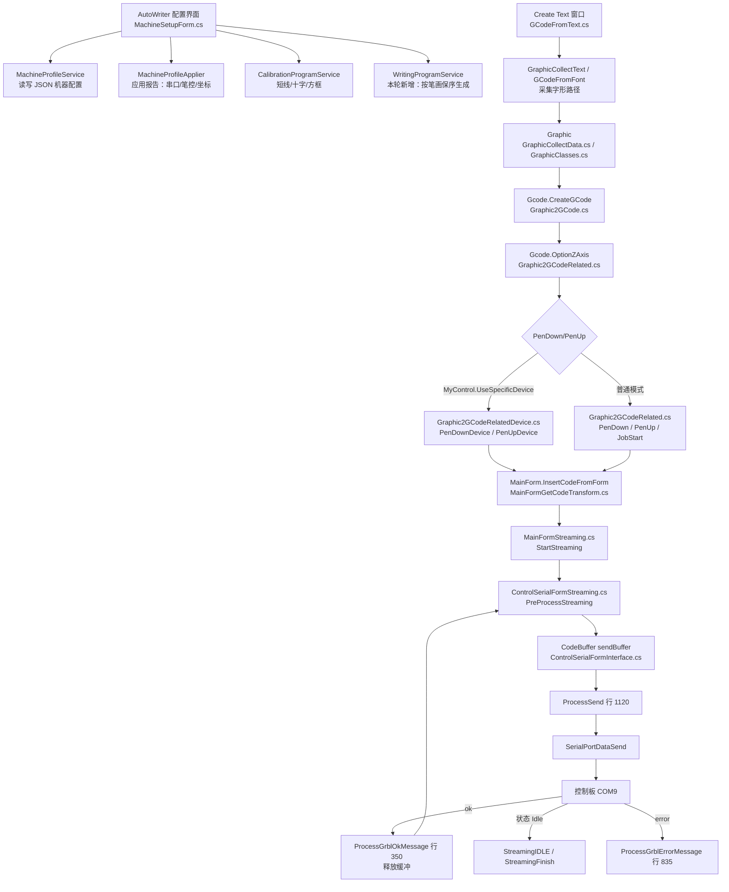

# 阶段 1 写字流程接入设计（离线）

编写日期：2026-10-05。本文件记录接手后第 3–5 项工作的结果：绘制现有 G-code 调用关系、实现显式的“应用机器配置”流程、把已验证的连续笔控接入正式生成（离线）。文中区分“源码已确认”“离线验证通过”“尚未实机验证”。

> 结论边界：本轮全部为离线开发与验证，没有连接 COM9、没有发送运动、没有写固件参数。阶段 1 仍未完成，机器配置仍为 Unverified。

## 1. 现有调用关系（源码已确认）

从“配置/文字界面”到“控制板”的完整链路：



关键点：

- 新增写字服务沿用与 `CalibrationProgramService` 相同的独立生成方式（自己输出 `G21/G90/G94/工作坐标系` 与显式 `G1`），不依赖底座全局工艺设置，因此不会因“应用配置”改动原有 Laser/Plotter 工艺。
- 串口仍然只有一个所有者（`_serial_form`）。写入不另建第二条串口发送路径。

## 2. 原有笔控入口与停留命令（源码已确认）

| 环节 | 位置 | 结论 |
|---|---|---|
| 笔控参数来源 | `Gcode.OptionZAxis`（`Graphic2GCodeRelated.cs:635`） | `Enable/Up/Down/Feed` 由 `GcodeDefaults`（读 `importGCZEnable/Up/Down/Feed`）或设备级映射覆盖 |
| 笔控值最终来源 | `MyControl.OverideGcodeSetup()`、`UCDevicePlotter` | 绘图设备可覆盖全局 Z 参数；改通用 `importGCZUp/Down` 不一定生效 |
| Z 模式落笔 | `Graphic2GCodeRelated.cs` `PenDown` / `Graphic2GCodeRelatedDevice.cs` `PenDownDevice` | `Plotter`+`OptionZAxis` 输出 `G1 Z{Down} F{Feed}` |
| Z 模式抬笔 | 同上 `PenUp` / `PenUpDevice` | `Plotter` 输出 `G0 Z{Up}`（**注意：底座抬笔用 G0、无 F**） |
| 停留命令 G4 插入点 | `Graphic2GCodeRelatedDevice.cs:87`、`:144`（PWM 的 `DlyDown/DlyUp`）；`Graphic2GCodeRelated.cs` 主轴延迟分支 | **只有 PWM/主轴延迟路径插入 `G4`；Z 笔控路径本身不插 G4** |
| 发送端强制停留 | `ControlSerialFormStreaming.cs:784-805` | 仅当程序含 `M0` 且启用“程序暂停”时，发送端会补 `G4 P1` 并 `waitForIdle=true`；**普通 G1 序列不等待 Idle** |
| `ok` 语义 | `ProcessGrblOkMessage`（:350）→ `PreProcessStreaming` | `ok` 表示被接受/入队并释放缓冲，**不代表运动完成**；完成判定依赖 Idle 状态 |

由此得到两条对本项目重要的推论：

1. 原软件的 `G1G90 Z0.0F10000`（抬笔）/`G1G90 Z5.0F10000`（落笔）**与底座设备路径不同**：底座抬笔是 `G0 Z{Up}`。为匹配这台定制固件已验证的表现，正式写字生成应由本项目的 `WritingProgramService` 输出 `G1 Z.. F..`（见第 4 节），而不是直接套用底座设备路径。
2. 连续笔控（落笔与 XY 之间不等 Idle）在**发送端天然成立**：只要生成程序不含 `M0`/`G4`，发送就是按字节缓冲连续供给。因此“不等 Idle”的约束落在**生成端**：不得插入同步块。

## 3. 显式“应用机器配置”流程（本轮新增，离线验证）

新增 `AutoWriter/Services/MachineProfileApplier.cs`：

- `BuildReport(profile)` 输出 `MachineApplyReport`，把“将要应用”的信息分组列出并逐项标注是否已知：
  - **串口**：候选协议、波特率、最近端口、固件标识；
  - **笔控**：方式（Z/PWM）、抬笔值、落笔值、绘图/空移/Z 速度、抬/落笔等待、落笔保持需连续运动；
  - **坐标**：纸面 X/Y/笔控对应轴、X/Y/Z 方向、工作坐标系、X/Y/Z 可用范围；
  - **验证**：状态、验证时间、证据条数。
- 未知值一律显示为“（未知）”，**绝不自动补成已验证值**。
- 结论分三级：
  - `CanGeneratePreview`：笔控值与三档速度齐全 → 可生成预览；
  - `CanStartWriting`：在此之上要求已验证状态、验证日期、证据、G54–G59、完整范围、连续笔控零停留；
  - 否则列出阻塞项。
- 阻塞项带**稳定 ASCII 代码**（`pen-unknown` / `speeds-unknown` / `workframe-unknown` / `bounds-unknown` / `unverified` / `dwell`），供程序与离线测试匹配；中文文案仅供界面显示。

界面：`MachineSetupForm` 新增“应用与写字预览”选项卡，显示报告、提供显式覆盖输入（留空用配置值）、生成示例笔画写字程序并导出。**报告只描述“将应用什么”，不写固件、不改原有工艺。**

## 4. 写字程序生成与连续笔控（本轮新增，离线验证）

新增 `AutoWriter/Models/WritingStroke.cs` 与 `AutoWriter/Services/WritingProgramService.cs`。

保序规则（与 `AutoWriter-二次开发说明.md` 第 4.2 节一致）：

```
页面 → 行 → 字符 → 字库笔画 → 笔画点序列
每一笔：抬笔 → 定位到起点 → 落笔 → 逐点绘制；跨笔画先抬笔再定位
```

生成格式（匹配已验证表现）：

```gcode
G21
G90
G94
G54                      ; 工作坐标系（未知则输出告警注释）
; 复核继承的 G92/TLO，本程序不取消偏移
; 连续笔控：落笔与绘图连续排队，不逐条等 Idle
G1 Z0 F300               ; 抬笔（只在上电首笔或由落笔态切换时输出一次）
G1 X1 Y11 F2000          ; 空移定位
G1 Z5 F300               ; 落笔
G1 X11 Y11 F1000         ; 紧接着绘图（中间无 G4）
; … 后续笔画 …
G1 Z0 F300               ; 收尾抬笔
```

连续笔控不变量与实现：

| 不变量 | 实现 |
|---|---|
| 连续笔控时禁止正数落笔/抬笔等待 | `Resolve` 在 `RequiresContinuousPenMotion==true` 且等待非 0 时抛错 |
| 连续笔控不输出 `G4` | 生成器对连续能力不做延迟输出 |
| 落笔行之后紧接 XY 绘制 | 生成器保证 `LowerPen()` 后第一条即绘制；`FindContinuousViolations(program, penDown)` 独立校验 |
| 未知笔位/速度不得静默填充 | 缺值即抛错（可用显式覆盖，但覆盖是操作者的明确决定） |
| 单点/空笔画不得静默丢弃 | 点数 < 2 的笔画直接抛错 |
| 越界检查 | 范围已知时逐点校验；预览可允许范围未知并输出告警，正式运行（`RequireVerifiedRun`）要求范围齐全 |

离线校验项 `FindContinuousViolations` 会报告：任何 `G4`、任何 `M0`、以及“落笔行后不是 XY 绘制”。

## 5. 本轮验证证据

均为离线，未连接控制板。

- `scripts/test-stage1-writing.ps1`（新增，独立进程运行）：连续配置 → 无 `G4`/`G0`/`M0`、落笔后紧接 XY、笔画保序、Z 值与速度正确；非连续+延迟 → 保留 `G4 P0.1/P0.2`；连续+正等待 → 拒绝；未知笔位 → 拒绝；越界 → 拒绝；单点笔画 → 拒绝；未验证配置 → 预览允许、正式运行拒绝；应用报告 → 未知项不误判、`unverified`/`speeds-unknown` 阻塞码正确。结果：PASS。
- `scripts/test-stage1-ui-smoke.ps1`（新增）：通过反射构造 `MachineSetupForm`，确认含 4 个选项卡（含“应用与写字预览”）可正常实例化；并校验发送集成接线——存在 `Action<string>` 构造重载、存在“生成并载入主界面预览”按钮。结果：PASS。
- `scripts/test-stage1-services.ps1` / `test-stage1-program.ps1` / `test-stage1-inspection.ps1`：回归通过（各自独立进程）。
- `scripts/build.ps1 -Configuration All -SkipRestore`：Debug 与 Release 均 0 错误。

> 注意：这些测试均在各独立 PowerShell 进程中运行。四个脚本会 `Add-Type` 同名类型的不同程序集，**在同一进程内连续运行会因类型身份冲突而失败**，属工具用法问题，不是回归。

## 6. 发送集成：生成 → 预览 → 发送（Stage 2，本轮完成）

目标：让界面里“生成写字程序”的产物直接进入主界面的 G-code 编辑器，复用原有**预览（2D 视图/模拟）→ 发送（StartStreaming）**链路，不必再走命令行安全壳。

实现（保持“只载入、不发送”）：

- `MachineSetupForm` 新增构造重载 `MachineSetupForm(Action<string> loadIntoPreview)`；无参构造链到 `this(null)`，反射测试与旧调用不受影响。
- “应用与写字预览”选项卡新增按钮 **“生成并载入主界面预览”**：若预览为空先按当前配置（含显式覆盖）生成，再把文本交给 `loadIntoPreview`。
- 新增 `AutoWriter/MainFormWriting.cs`（`MainForm` 分部类）方法 `LoadWritingIntoPreview(string)`：
  - `isStreaming` 为真时**拒绝**（正在发送/流式运行不得换程序）；
  - 空文本拒绝；
  - 调用既有 `MainFormGetCodeTransform.InsertCodeFromForm(program, "from AutoWriter writing")`，与 Text/Shape/Image 等导入同一条路径；
  - **不调用任何发送/流式方法**，不自动连接串口。
- 主界面 `AutoWriter` 菜单打开配置窗口时传入该回调（`new AutoWriter.MachineSetupForm(LoadWritingIntoPreview)`）。

安全边界：

- 载入只是把代码放进编辑器；**发送仍由操作者在原有“发送”按钮上显式触发**，前置检查（`$1`、模态、偏移、报警）由既有流程负责。
- 未验证配置生成的程序自带 `; PREVIEW ONLY …` 注释，提示运行前必须现场核验。
- G92/TLO 偏移仍不由生成程序取消（与第 4 节一致），发送前的核对责任不变。

## 7. 尚未完成 / 下一步

- **实机小字验证**（需现场）：已按“王 5mm → 多字行 → 字号对比 → 端到端发送”顺序完成（见 `阶段1-使用与实机验收.md` 与 `开发记录.md`）。字形均为**内置直线中心线几何**，字体/排版流程尚未接入。
- **配置应用落地**：当前报告只做展示；是否把已验证值写入底座 `GcodeDefaults`/Settings（全局状态，见开发说明 4.4）留待设计。
- **Z 抬/落笔绝对值与真实行程**：仍未知，配置保持 Unverified；不得用截图 Z=5 当作已验证落笔值。
- **暂停/恢复/取消的机械结果**：仍待实机核对；发送端收尾 `fix overflow` 记账告警路径需一并观察。
- **界面端到端**：已走通“生成并载入主界面预览 → 开始模拟 → 绿色 ▶ 发送”，纸面「工」目视通过（约 4 秒、`streaming finished ok True`）。**暂停/取消走查仍未做**；连续笔控在正式发送链路下的落笔横移保持**本次未目视确认**。
- **收尾回位**：生成程序结尾只抬笔不回原点，实测后由操作者手动回位；是否在程序中加回位需先确认行程与安全边界。
